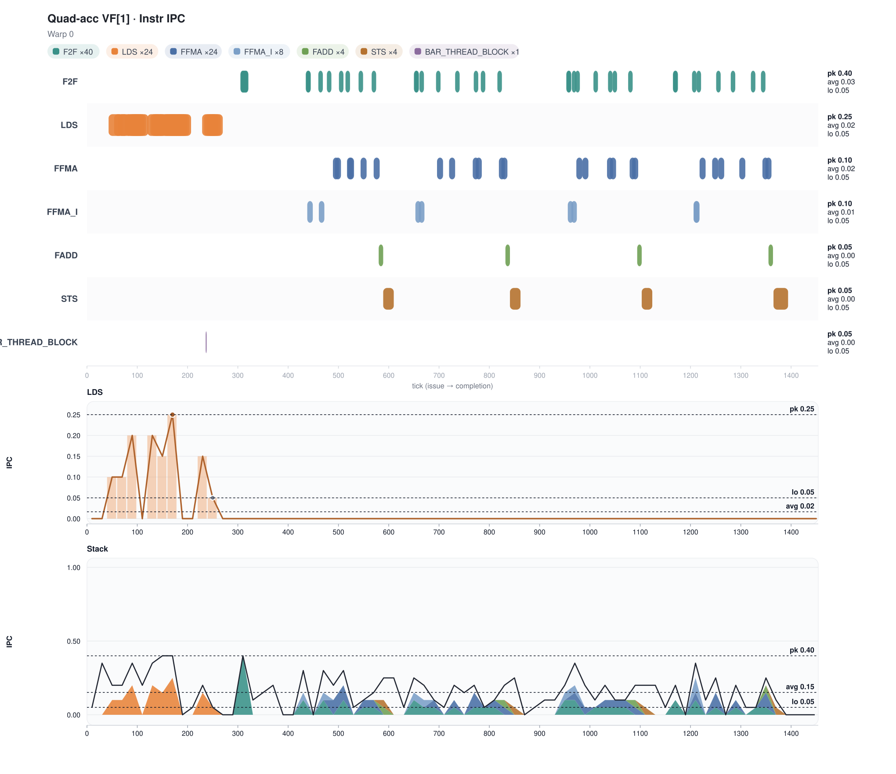
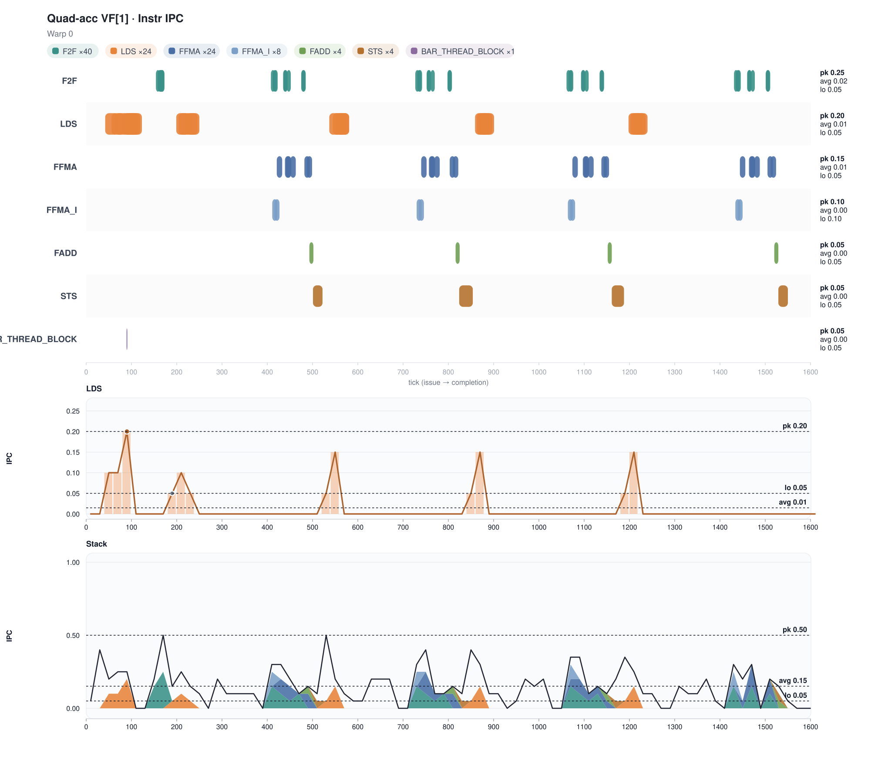

# LDS performance — `A[k, n]` GEMV

`x[k]` is one K-vector. `A[k, n]` stores `n` contiguously. Thread `n` computes `Out[n] = Σ_k A[k, n] · x[k]`.

Numbers are N=2048, K=8, 256 threads, rerun on the current TileLang (`562cbc7c`, 2026-11-18). All schedules pass (max abs 1.2e-07). Provenance: `results_rebuild.txt`; traces under `runs/<tag>/npusim/`. Charts are in `plots/`.

## Contents

1. [Layout](#1-layout) — the address pattern and its CCE ceiling.
2. [CCE line](#2-cce-line-at-256-threads) — what a bare CCE load loop scores.
3. [V1 / V2 / V3](#3-v1--v2--v3) — the three schedules and their numbers.
4. [Why V1 is slower](#4-why-the-higher-band-is-slower) — band vs el/cyc, and where the ticks go.
5. [Instruction charts](#5-instruction-charts) — LDS-focused IPC for V1 and V3.
6. [How to get closer](#6-how-to-get-closer) — the levers, in order of payoff.
6. [Spills](#7-spills) — V3's schedule, the register math, and why the spill clogs the band.
7. [Conclusion](#8-conclusion)

## 1. Layout

- `x` is loaded once per thread and reused.
- `A` is packed to `uint32`: word `(c, n)` holds fp16 pair `(A[2c, n], A[2c+1, n])`.
- Lane `t` reads word `base + t`. Neighbors are 4 B apart.
- One warp issue is 32 × 4 B = **128 B**, banks 0–31 once.
- K=8 is four such issues per output.

```text
word:   j    j+1   j+2  ... j+31
lane:   L0   L1    L2   ... L31
bank:    0    1     2   ...  31
```

CCE of this address, loads only, no FFMA (`79.92 B/cyc`):

```36:43:benches/sv3/lds-boost/a_row8_pack.asc
#elif PACK == 2
  // Transposed UB: u32 index = tid + i*T (pure-bench shape, same kU32 loads).
  constexpr int kLoads = kU32 / kThreads;
  uint32_t v[kLoads];
#pragma unroll
  for (int i = 0; i < kLoads; ++i) v[i] = src[tid + i * kThreads];  // 4 B stride
#pragma unroll
  for (int i = 0; i < kLoads; ++i) acc += v[i];
```

The old `A[n, k]` layout put 16 B between lanes and scored **29.36 B/cyc**. That is not this layout.

## 2. CCE line at 256 threads

| Case | Stride | B/issue | B/cyc |
|---|---:|---:|---:|
| Pure pack | 4 B | 128 | 81.11 |
| This GEMV byte count, loads only | 4 B | 128 | **79.92** |
| Size-scaled fp32 | 4 B | 128 | 76.38 |
| Old `A[n, k]` | 16 B | 128 | 29.36 |
| Scalar fp16 | 2 B | 64 | 34.79 |

97.72 B/cyc needs 1024 threads. It is not the ceiling for this case. 79.92 counts loads only.

## 3. V1, V2, V3

Same math, same `A[k, n]` addresses. The difference is when FFMA runs. V2 also widens the lane load.

| | Order | VF | el/cyc | Load band | LDK/STK |
|---|---|---:|---:|---:|---:|
| **V1** | Load 4 rows, then FFMA | 8373 | 0.24 | **63.75** | 512/512 |
| **V2** | One row, but 8 B between lanes | 4296 | **0.48** | 15.89 | 512/512 |
| **V3** | Load one row, FFMA, store, next row | 4424 | 0.46 | 28.15 | 512/512 |

V1 source: all loads, then all FFMAs.

```124:142:benches/sv3/lds-boost/kernels_flip.py
                    for q in T.serial(4):
                        for n, c in T.Parallel(threads, kh):
                            wa[q, n, c] = a_t_ub[c, q * threads + n]
                    # ---- UNPACK + MAC phase
                    for q in T.serial(4):
                        accA = T.alloc_fragment((threads,), "float32")
                        accB = T.alloc_fragment((threads,), "float32")
                        for n in T.Parallel(threads):
                            accA[n] = T.float32(0)
                            accB[n] = T.float32(0)
                        for n, c in T.Parallel(threads, kh):
                            plo[q, n, c] = T.reinterpret(
                                T.Cast("uint16", wa[q, n, c] & T.uint32(0xFFFF)), "float16")
                            phi[q, n, c] = T.reinterpret(
                                T.Cast("uint16", wa[q, n, c] >> T.uint32(16)), "float16")
                        for c in T.serial(kh):
                            for n in T.Parallel(threads):
                                accA[n] = accA[n] + T.Cast("float32", plo[q, n, c]) * xfa[c]
                                accB[n] = accB[n] + T.Cast("float32", phi[q, n, c]) * xfb[c]
```

V3 source: one row is finished before the next load.

```190:200:benches/sv3/lds-boost/kernels_flip.py
                        for n, c in T.Parallel(threads, kh):
                            wa[n, c] = a_t_ub[c, q * threads + n]
                        for n, c in T.Parallel(threads, kh):
                            plo[n, c] = T.reinterpret(
                                T.Cast("uint16", wa[n, c] & T.uint32(0xFFFF)), "float16")
                            phi[n, c] = T.reinterpret(
                                T.Cast("uint16", wa[n, c] >> T.uint32(16)), "float16")
                        for c in T.serial(kh):
                            for n in T.Parallel(threads):
                                accA[n] = accA[n] + T.Cast("float32", plo[n, c]) * xfa[c]
                                accB[n] = accB[n] + T.Cast("float32", phi[n, c]) * xfb[c]
```

Generated V1 load. Lane `t` and lane `t+1` are one word apart:

```19:19:benches/sv3/lds-boost/runs/v1_burst-n2048-k8-t256/kernel.cpp
      wa[((q * 4) + i_1)] = ((__ubuf__ uint32_t*)buf_dyn_shmem)[(((i_1 * 1024) + (q * 256)) + ((int32_t)threadIdx.x))];
```

## 4. Why the higher band is slower

- **Load band** = A bytes / union of LDS issue-to-done windows. FFMA after the last load is not in the denominator.
- **el/cyc** = outputs / full VF. That is the kernel.

```text
V1  [192 loads, 257 ticks][unpack + spill + FFMA, ~1200 ticks]  → 63.75 B/cyc, 0.24 el/cyc
V3  [4 loads][FFMA][4 loads][FFMA] ...                          → 28.15 B/cyc, 0.46 el/cyc
```

V1's band is high because the 192 loads overlap. The FFMA is still there, after the band. V3 is faster end to end because each row computes as soon as it is loaded. V2 is fastest end to end and slowest on the band: 8 B between lanes is a 2-way bank clash.

Busy unions on the steady VF make the split exact:

| VF | span | LDS busy | F2F busy | FFMA busy | STK+LDK busy |
|---|---:|---:|---:|---:|---:|
| V1 steady | 1459 | **257** | 750 | 635 | 1044 + 1063 |
| V3 steady | 1607 | 577 | 488 | 492 | 1131 + 1135 |

- V1 finishes all loads in 257 ticks (63.75 B/cyc), then spends ~1200 ticks in unpack, spill traffic, FFMA, and stores.
- V3 interleaves: the load union is stretched to 577 ticks (28.15 B/cyc), but the same work pipeline finishes in 1607 instead of 1459+… — one VF, not two phases.
- V1's cold VF pays the extra on top: span 6914 vs V3's 2817. First-touch of the 16-word spill frame (`wa[16]`, `plo[16]`, `phi[16]`) is why the cold launch is so much worse.

Turning off `asc_syncthreads` on V3 did not help (VF 4812, 0.43 el/cyc, band 25.32, spills still 512/512).

## 5. Instruction charts

Charts use the `charts/web` method: issue ticks binned by 20, issues per tick. **Instr IPC** is warp 0; the focus panel is `LDS`. **Warp IPC** is all 8 warps. Steady VF (VF[1]) of each arm.

**V1** — `plots/v1_instr_lds.png`, `plots/v1_warps.png`:




One LDS burst at the head; the rest of the row is unpack/FFMA/STS with the STK/LDK stack on top.

**V3** — `plots/v3_instr_lds.png`, `plots/v3_warps.png`:




Four LDS groups, one per row, each followed by its FFMA block.

## 6. How to get closer

Order by measured payoff. The banks are already clean; the loss is pipeline order and the unpack lowering.

1. **Drop the pointer pun.** `T.reinterpret(Cast uint16, w & 0xFFFF)` lowers to `*(half*)(&v_)`, and bisheng sends it plus its arrays (`wa[]`, `plo[]`, `phi[]`) through the stack — the 512 STK + 512 LDK per VF are exactly this. The register-safe convert already exists in codegen: a vectorized `half2 → float2` cast emits `__half22float2` (`codegen_ascend.cc`, `PrintVectorizedCast`). If TileLang lowers the packed-pair unpack to that intrinsic, both V1 and V3 lose the stack round-trip. This is the single biggest lever left on this layout.
2. **Fuse unpack into FFMA.** `half2` math or `FFMA_I`-style paired products would remove the separate `F2F` wave. The schedule kernels already run `F2F` at 8 cycles/issue and `FFMA` at 11–12; fusing removes one of the two dependent streams.
3. **Software-pipeline the rows (V4).** Keep V3's order but prefetch row `q+1` while computing row `q`. V1 proves the loads can overlap (257-tick burst); V3 proves per-row compute overlaps nothing. The ideal steady VF is roughly `max(load time, compute time) + drain`, not their sum. On paper: 257 ticks of loads against ~1350 ticks of unpack+FFMA — the wall is compute, so pipelining alone buys little until the spills in (1) are gone. With spills removed the two sides become comparable and the overlap starts to pay.
4. **A dedicated packed-arithmetic op.** A `T.hl.muladd_pair` (two fp16 products from one u32 word, one FFMA each) would skip the unpack entirely. That is a TileLang Ascend builtin, not a schedule.

What will not move the needle: `--nosync` (measured, VF got worse), 512 threads (barrier cost grows), and `__launch_bounds__` / `__maxnreg__` (spills are not a register-count problem, §7).

## 7. Spills

- Every schedule does 512 stack stores and 512 reloads per VF.
- In V3 the eight stores per row are the eight `x` floats (`xfa[4]`, `xfb[4]`), spilled while `A` is unpacked, then reloaded for FFMA. In V1 the 16-word frame (`wa[16]`, `plo[16]`, `phi[16]`) is the cold-VF cost.
- They are not pressure: the values fit with room to spare. The pun forces memory.

| Live set | Registers | Share of 128 KB |
|---|---:|---:|
| `x` only | 8 | 6% |
| `x` + 4 A words + halves + 2 accs | 18 | 14% |

Removing `__launch_bounds__(256)` left the spills at 512/512. `--nosync` left them too. Running 128 threads left them too (PASS, VF 6414, 0.32 el/cyc — 512 again: half the warps, twice the rows per thread). Even spelling every x as its own scalar `T.alloc_var` with no array anywhere left them at 512/512 (`probe-xv_scalars`, VF 5266). TileLang has no register-pinning knob — `alloc_var`/`alloc_fragment` are storage scopes, and `T.set_max_nreg` is CUDA-only.

A schedule change does separate the two effects. Unpacking into float UB first and only then loading x (`reorder`, and `split` with the MAC in its own VF) leaves the MAC with **zero** STK/LDK. The 512 that remain are the pun itself: each `*(half*)(&v_)` is one stack store of the `uint16` and one stack reload as `half`, and that round-trip is inside the unpack, before x is live. Both schedules are slower end to end (VF 10358 and 10509, 0.20 and 0.19 el/cyc) because the unpack is now its own stack-bound pass. Rebuilding V3 with the bisheng knobs that talk about registers or the stack — `--cce-simt-maxrregcount` at 32 and at 128 (255 is rejected; the legal range is `(0, 128]`), frame elimination, rematerialization, the SIMT pattern opts, and `--cce-disable-vf-stack-reserved-ubuf` — leaves the count at 512/512. Capping the file at 32 registers does not add spills, so this is not a register-budget choice. The probe log is `SPILL_PROBES.md`.

### 7.1 V3's schedule, instruction by instruction

Steady VF (VF[1], span 1607 ticks) of `v3_row-n2048-k8-t256`. First-issue order per PC, relative to VF start:

```text
+  17   S2R / SHFI / IADD_I / MOVI   (×8 each)   address setup for x and A
+  42   LDS ×8  (+42 … +95)                      the x row: 8 scalar fp16 loads
+  89   BAR_THREAD_BLOCK                         block barrier
+ 153   S2R ×8                                   row pointer setup
+ 154   F2F ×8                                   x halves → float
+ 199   LDS ×4  (+199 … +222)                    row q: 4 packed u32 words, 4 B/lane
+ 236   STK ×8  (+236 … +369)  ← THE SPILL      x floats written to stack
+ 252   LDK ×8                  ← THE RELOAD    x floats read back for FFMA
+ 407   F2F + FFMA (+FFMA_I) ×8                  row q products
+ 501   STS ×1                                   out_ub store
+ 505   BRANCH                                   next row (q++)
...     the same block repeats at +537, +859, +1198
+1546   END
```

The stack ops are not scattered. The trace shows four stack-busy segments — `(236,503)`, `(576,863)`, `(895,1200)`, `(1235,1549)` — one per row, and each starts right after that row's four A loads land and ends as its FFMA block begins. Eight stores then eight loads, per row, 4 rows, 8 warps: `8 × 4 × 8 = 256` STK and 256 LDK per VF, the 512/512.

### 7.2 Register math: the spills are not needed

Per-thread live values at the spill point (row q of V3, after the A loads land):

| Value | Count | Registers | Notes |
|---|---:|---:|---|
| `xfa[4]` + `xfb[4]` | 8 | 8 | the x vector, fp32 |
| `wa[4]` | 4 | 4 | packed A words for this row |
| `plo[4]` + `phi[4]` | 8 halves | 4 | unpacked A halves, packable 2/reg |
| `accA` + `accB` | 2 | 2 | accumulators |
| loop/misc | — | ~4 | q, base pointers |
| **Total live** | | **~22** | |

At 256 threads the register file is 128 KB = 224 KB FP + 32 KB GP mapped as **128 registers per thread**. 22 live registers is **17%** of the file. Even the pessimistic count (halves unpacked 1/reg, no packing) is 26 registers = 20%.

The same arithmetic on the *stack* side: 256 STK + 256 LDK per VF. Each STK stays active 27–48 ticks (median 36). The four stack segments total **1173 busy ticks** — 73% of the 1607-tick VF, and longer than the LDS busy union (577) and the FFMA busy union (492) *combined*.

### 7.3 The spill is what clogs the load band

The claim "loads are the wall" is falsified by the per-bin op mix. In bins of 60 ticks across the steady VF:

```text
tick-bin   LDS    F2F    STK    LDK   FFMA
   0- 59     8      0      0      0      0
  60-119    55      0      0      0      0
 120-179     1     64      0      0      0
 180-239    32      0      2      0      0   ← row loads land
 240-299     0      0     18     16      0   ← stack only
 300-359     0      0     20     20      0   ← stack only
 360-419     0     12     16     12      0
 420-479     0     37      8     16     29   ← FFMA, still stack on top
 480-539     1     15      0      0     19   ← row done, next row starts
 540-599    29      0      4      4      0   ← next row loads
 600-659     2      0     21     13      0   ← stack again
  ...        the pattern repeats at +860, +1200
```

Between the row loads the pipe runs stack traffic alone: bins `240–359`, `600–719`, `960–1079`, `1320–1439` are STK/LDK with **zero** LDS. That is ~480 ticks of pure stack in the middle of where the loads could have been running.

The band arithmetic: one slab of A is 16384 B. Spread over the LDS busy union of 577 ticks, that is **28.15 B/cyc**. But the LDS issues themselves are clean — 192 issues, each active 27–46 ticks — and the address pattern is one bank per lane. What stretches the union to 577 is that each row's loads *wait* behind the previous row's 265-tick stack block. Remove the stack round-trip and the four row-load batches can sit back-to-back, the same way V1's 192 loads finish in 257 ticks (**63.75 B/cyc**) with identical addresses. The band loss is the spill's scheduling shadow, not the memory system.

CCE proof: `a_row8_pack.asc`, same addresses, no unpack, no stack — **79.92 B/cyc**.

## 8. Conclusion

- The layout is right: 128 B/issue, one bank per lane, 79.92 B/cyc reachable in CCE.
- V1 shows that load pattern at **63.75 B/cyc** — the banks are not the problem. But V1 is the slowest kernel (**0.24 el/cyc**): its band is a 257-tick burst followed by a ~1200-tick serial tail.
- V3 is the better kernel (**0.46 el/cyc**) because compute follows each load instead of trailing all of them.
- V3's 28.15 B/cyc band is not the memory system. Between row loads the pipe runs stack-only bins (~480 ticks per VF): 22 live registers spill to the stack 512 times because of the `*(half*)(&v_)` pun. Fix the lowering (§6.1) and the same addresses have V1's 63.75 B/cyc behind them.
