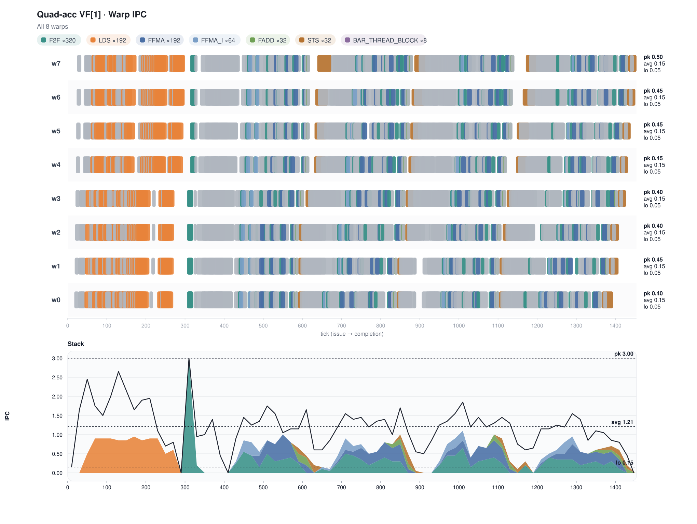
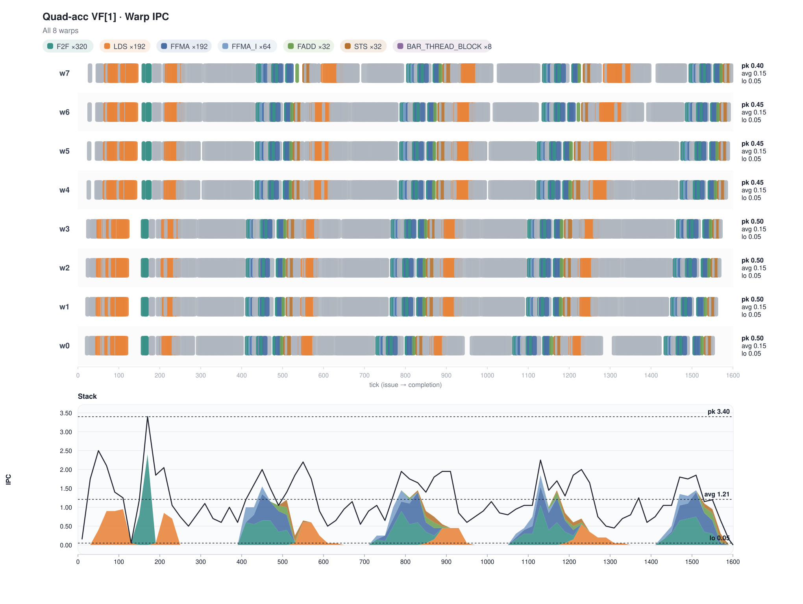

# LDS performance — `A[k, n]` GEMV

`x[k]` is one K-vector. `A[k, n]` stores `n` contiguously. Thread `n` computes `Out[n] = Σ_k A[k, n] · x[k]`.

Numbers are N=2048, K=8, 256 threads, rerun on the current TileLang (`562cbc7c`, 2026-11-18). All schedules pass (max abs 1.2e-07). Provenance: `logs/results_rebuild.txt`; traces under `runs/<tag>/npusim/`. Charts are in `plots/`.

## Contents

1. [Layout](#1-layout) — the address pattern and its CCE ceiling.
2. [CCE line](#2-cce-line-at-256-threads) — what a bare CCE load loop scores.
3. [V1 / V2 / V3](#3-v1-v2-v3) — the three schedules and their numbers.
4. [Why V1 is slower](#4-why-the-higher-band-is-slower) — band vs el/cyc, and where the ticks go.
5. [Instruction charts](#5-instruction-charts) — LDS-focused IPC for V1 and V3.
6. [How to get closer](#6-how-to-get-closer) — the levers, in order of payoff.
7. [Spills](#7-spills) — V3's schedule, and why the spill clogs the band.
8. [CCE V3](#8-cce-v3) — the same schedule written by hand, and the compiler knobs.
9. [Theoretical registers vs what actually spills](#9-theoretical-registers-vs-what-actually-spills) — the register math, the trace-level proof, and the TileLang/CCE comparison.
10. [Conclusion](#10-conclusion)

## 1. Layout

- `x` is loaded once per thread and reused.
- `A` is packed to `uint32`: word `(c, n)` holds fp16 pair `(A[2c, n], A[2c+1, n])`.
- Lane `t` reads word `base + t`. Neighbors are 4 B apart.
- One warp issue is 32 × 4 B = **128 B**, banks 0–31 once.
- K=8 is four such issues per output.

**Figure 1.** One warp issue. Lane `t` and lane `t+1` are one word, 4 B, apart.

```text
word:   j    j+1   j+2  ... j+31
lane:   L0   L1    L2   ... L31
bank:    0    1     2   ...  31
```

CCE of this address, loads only, no FFMA (`79.92 B/cyc`):

```36:43:work/ST-Analysis/SV3/lds-boost/cce/a_row8_pack.asc
#elif PACK == 2
  // Transposed UB: u32 index = tid + i*T (pure-bench shape, same kU32 loads).
  constexpr int kLoads = kU32 / kThreads;
  uint32_t v[kLoads];
#pragma unroll
  for (int i = 0; i < kLoads; ++i) v[i] = src[tid + i * kThreads];  // 4 B stride
#pragma unroll
  for (int i = 0; i < kLoads; ++i) acc += v[i];
```

The old `A[n, k]` layout put 16 B between lanes and scored **29.36 B/cyc**. That is not this layout.

## 2. CCE line at 256 threads

**Table 1.** CCE ceilings at 256 threads.

| Case | Stride | B/issue | B/cyc |
|---|---:|---:|---:|
| Pure pack | 4 B | 128 | 81.11 |
| This GEMV byte count, loads only | 4 B | 128 | **79.92** |
| Size-scaled fp32 | 4 B | 128 | 76.38 |
| Old `A[n, k]` | 16 B | 128 | 29.36 |
| Scalar fp16 | 2 B | 64 | 34.79 |

97.72 B/cyc needs 1024 threads. It is not the ceiling for this case. 79.92 counts loads only.

## 3. V1, V2, V3

Same math, same `A[k, n]` addresses. The difference is when FFMA runs. V2 also widens the lane load.

**Table 2.** The three TileLang schedules. N=2048, K=8, 256 threads.

| | Order | VF | el/cyc | Load band | LDK/STK |
|---|---|---:|---:|---:|---:|
| **V1** | Load 4 rows, then FFMA | 8373 | 0.24 | **63.75** | 512/512 |
| **V2** | One row, but 8 B between lanes | 4296 | **0.48** | 15.89 | 512/512 |
| **V3** | Load one row, FFMA, store, next row | 4424 | 0.46 | 28.15 | 512/512 |

V1 source: all loads, then all FFMAs.

```124:142:work/ST-Analysis/SV3/lds-boost/src/kernels_flip.py
                    for q in T.serial(4):
                        for n, c in T.Parallel(threads, kh):
                            wa[q, n, c] = a_t_ub[c, q * threads + n]
                    # ---- UNPACK + MAC phase
                    for q in T.serial(4):
                        accA = T.alloc_fragment((threads,), "float32")
                        accB = T.alloc_fragment((threads,), "float32")
                        for n in T.Parallel(threads):
                            accA[n] = T.float32(0)
                            accB[n] = T.float32(0)
                        for n, c in T.Parallel(threads, kh):
                            plo[q, n, c] = T.reinterpret(
                                T.Cast("uint16", wa[q, n, c] & T.uint32(0xFFFF)), "float16")
                            phi[q, n, c] = T.reinterpret(
                                T.Cast("uint16", wa[q, n, c] >> T.uint32(16)), "float16")
                        for c in T.serial(kh):
                            for n in T.Parallel(threads):
                                accA[n] = accA[n] + T.Cast("float32", plo[q, n, c]) * xfa[c]
                                accB[n] = accB[n] + T.Cast("float32", phi[q, n, c]) * xfb[c]
```

V3 source: one row is finished before the next load.

```190:200:work/ST-Analysis/SV3/lds-boost/src/kernels_flip.py
                        for n, c in T.Parallel(threads, kh):
                            wa[n, c] = a_t_ub[c, q * threads + n]
                        for n, c in T.Parallel(threads, kh):
                            plo[n, c] = T.reinterpret(
                                T.Cast("uint16", wa[n, c] & T.uint32(0xFFFF)), "float16")
                            phi[n, c] = T.reinterpret(
                                T.Cast("uint16", wa[n, c] >> T.uint32(16)), "float16")
                        for c in T.serial(kh):
                            for n in T.Parallel(threads):
                                accA[n] = accA[n] + T.Cast("float32", plo[n, c]) * xfa[c]
                                accB[n] = accB[n] + T.Cast("float32", phi[n, c]) * xfb[c]
```

Generated V1 load. Lane `t` and lane `t+1` are one word apart:

```19:19:work/ST-Analysis/SV3/lds-boost/runs/v1_burst-n2048-k8-t256/kernel.cpp
      wa[((q * 4) + i_1)] = ((__ubuf__ uint32_t*)buf_dyn_shmem)[(((i_1 * 1024) + (q * 256)) + ((int32_t)threadIdx.x))];
```

## 4. Why the higher band is slower

- **Load band** = A bytes / union of LDS issue-to-done windows. FFMA after the last load is not in the denominator.
- **el/cyc** = outputs / full VF. That is the kernel.

```text
V1  [192 loads, 257 ticks][unpack + spill + FFMA, ~1200 ticks]  → 63.75 B/cyc, 0.24 el/cyc
V3  [4 loads][FFMA][4 loads][FFMA] ...                          → 28.15 B/cyc, 0.46 el/cyc
```

V1's band is high because the 192 loads overlap. The FFMA is still there, after the band. V3 is faster end to end because each row computes as soon as it is loaded. V2 is fastest end to end and slowest on the band: 8 B between lanes is a 2-way bank clash.

Busy unions on the steady VF make the split exact:

**Table 3.** Busy unions on the steady VF, in ticks.

| VF | span | LDS busy | F2F busy | FFMA busy | STK+LDK busy |
|---|---:|---:|---:|---:|---:|
| V1 steady | 1459 | **257** | 750 | 635 | 1044 + 1063 |
| V3 steady | 1607 | 577 | 488 | 492 | 1131 + 1135 |

- V1 finishes all loads in 257 ticks (63.75 B/cyc), then spends ~1200 ticks in unpack, spill traffic, FFMA, and stores.
- V3 interleaves: the load union is stretched to 577 ticks (28.15 B/cyc), but the same work pipeline finishes in 1607 instead of 1459+… — one VF, not two phases.
- V1's cold VF pays the extra on top: span 6914 vs V3's 2817. First-touch of the 16-word spill frame (`wa[16]`, `plo[16]`, `phi[16]`) is why the cold launch is so much worse.

Turning off `asc_syncthreads` on V3 did not help (VF 4812, 0.43 el/cyc, band 25.32, spills still 512/512).

## 5. Instruction charts

Charts use the `charts/web` method: issue ticks binned by 20, issues per tick. **Instr IPC** is warp 0; the focus panel is `LDS`. **Warp IPC** is all 8 warps. Steady VF (VF[1]) of each arm.

**Figure 2.** V1, instruction IPC, warp 0, LDS focus. `plots/v1_instr_lds.png`.


**Figure 3.** V1, warp IPC, all 8 warps. `plots/v1_warps.png`.



- One LDS burst at the head. The rest of the span is unpack, FFMA, and STS.

**Figure 4.** V3, instruction IPC, warp 0, LDS focus. `plots/v3_instr_lds.png`.


**Figure 5.** V3, warp IPC, all 8 warps. `plots/v3_warps.png`.



- Four LDS groups, one per row, each followed by its FFMA block.
- STK and LDK are drawn. They are rows of their own, and bands in the stack, in crimson and purple. A figure that should hide them passes `--skip STK,LDK` to `export_json.py`.

## 6. How to get closer

Order by measured payoff. The banks are already clean; the loss is pipeline order and the unpack lowering.

1. **Drop the pointer pun.** `T.reinterpret(Cast uint16, w & 0xFFFF)` lowers to `*(half*)(&v_)`, and bisheng sends it plus its arrays (`wa[]`, `plo[]`, `phi[]`) through the stack — the 512 STK + 512 LDK per VF are exactly this. The register-safe convert already exists in codegen: a vectorized `half2 → float2` cast emits `__half22float2` (`codegen_ascend.cc`, `PrintVectorizedCast`). If TileLang lowers the packed-pair unpack to that intrinsic, both V1 and V3 lose the stack round-trip. This is the single biggest lever left on this layout.
2. **Fuse unpack into FFMA.** `half2` math or `FFMA_I`-style paired products would remove the separate `F2F` wave. The schedule kernels already run `F2F` at 8 cycles/issue and `FFMA` at 11–12; fusing removes one of the two dependent streams.
3. **Software-pipeline the rows (V4).** Keep V3's order but prefetch row `q+1` while computing row `q`. V1 proves the loads can overlap (257-tick burst); V3 proves per-row compute overlaps nothing. The ideal steady VF is roughly `max(load time, compute time) + drain`, not their sum. On paper: 257 ticks of loads against ~1350 ticks of unpack+FFMA — the wall is compute, so pipelining alone buys little until the spills in (1) are gone. With spills removed the two sides become comparable and the overlap starts to pay.
4. **A dedicated packed-arithmetic op.** A `T.hl.muladd_pair` (two fp16 products from one u32 word, one FFMA each) would skip the unpack entirely. That is a TileLang Ascend builtin, not a schedule.

What will not move the needle: `--nosync` (measured, VF got worse), 512 threads (barrier cost grows), and `__launch_bounds__` / `__maxnreg__` (spills are not a register-count problem, §7).

## 7. Spills

- Every schedule does 512 stack stores and 512 reloads per VF.
- What is spilled is neither `x`, nor `wa`, nor the accumulators. Following the PC chain, each packed word produces exactly **2 STK + 2 LDK**: one pair per extracted half. Per word, `SHFI` computes `w >> 16`, one STK truncates the low 16 bits into a 2-byte slot, one STK stores the shifted high half, and two LDK read those slots back as `half`. Those are the `v_` / `v__1` intermediates of the pun, on their way to `plo`/`phi`. The x floats are converted once at the VF head and consumed by FFMA with no stack op between. That is 8 STK + 8 LDK per row, 8 warps × 4 rows = 256 each per VF.
- Byte-wise: 2 B per lane, 32 lanes, 256 issues = 16 KB written + 16 KB read, **32 KB of stack traffic per VF** — more than the block's entire 22 KB live set (§9).
- The live set that would have to fit is ~88 B per thread, 22 KB across 256 threads (§9). The spill is not that budget.

- **Nothing we tried removes them:**

- Removing `__launch_bounds__(256)` — still 512/512.
- `--nosync` — still 512/512.
- 128 threads — still 512/512 (PASS, VF 6414, 0.32 el/cyc: half the warps, twice the rows per thread).
- Every `x` spelled as its own scalar `T.alloc_var`, no array anywhere — still 512/512 (`probe-xv_scalars`, VF 5266).
- TileLang has no register-pinning knob: `alloc_var`/`alloc_fragment` are storage scopes, and `T.set_max_nreg` is CUDA-only.

- **A schedule change separates the two effects:**

- **Reorder / split** — unpack into float UB first, then load `x` and MAC (split puts the MAC in its own VF). Both pass, and the MAC itself has **zero** STK/LDK. The 512 that remain are the pun itself: each `*(half*)(&v_)` is one stack store of the `uint16` and one stack reload as `half`, and that round-trip sits inside the unpack, before `x` is live.
- Both schedules are slower end to end (VF 10358 and 10509, 0.20 and 0.19 el/cyc) because the unpack is now its own stack-bound pass.

- **The bisheng knobs do not change the count.** All of these stay 512/512:

**Table 4.** TileLang V3 rebuilt with bisheng register and stack flags. All 512/512.

| Flag | VF | el/cyc |
|---|---:|---:|
| `--cce-simt-maxrregcount=128` (top of the legal range; 255 is rejected, range is `(0, 128]`) | 4274 | 0.48 |
| `--cce-simt-maxrregcount=32` | 4337 | 0.47 |
| frame elimination + frame-stack opt (`-mllvm`) | 4340 | 0.47 |
| rematerialization (`-mllvm`, three passes) | 4315 | 0.47 |
| SIMT pattern + memop combine (`-mllvm`) | 4246 | 0.48 |
| `--cce-disable-vf-stack-reserved-ubuf` | 4314 | 0.47 |

- Capping the file at 32 registers does not add spills, so this is not a register-budget choice.
- The probe log is `SPILL_PROBES.md`. Numbers are in `logs/results_probe.txt` and `logs/results_sched.txt`.

### 7.1 V3's schedule, instruction by instruction

- Steady VF (VF[1], span 1607 ticks) of `v3_row-n2048-k8-t256`. First-issue order per PC, relative to VF start:

```text
+  17   S2R / SHFI / IADD_I / MOVI   (×8 each)   address setup for x and A
+  42   LDS ×8  (+42 … +95)                      the x row: 8 scalar fp16 loads
+  89   BAR_THREAD_BLOCK                         block barrier
+ 153   S2R ×8                                   row pointer setup
+ 154   F2F ×8                                   x halves → float
+ 199   LDS ×4  (+199 … +222)                    row q: 4 packed u32 words, 4 B/lane
+ 236   STK ×8  (+236 … +369)  ← THE SPILL      the 8 halves of this row's 4 words
+ 252   LDK ×8                  ← THE RELOAD    those slots read back as half
+ 407   F2F + FFMA (+FFMA_I) ×8                  row q products
+ 501   STS ×1                                   out_ub store
+ 505   BRANCH                                   next row (q++)
...     the same block repeats at +537, +859, +1198
+1546   END
```

- The stack ops are not scattered. Four stack-busy segments, one per row: `(236,503)`, `(576,863)`, `(895,1200)`, `(1235,1549)`.
- Each segment starts right after that row's four A loads land and ends as its FFMA block begins.
- Eight stores then eight loads, per row, 4 rows, 8 warps: `8 × 4 × 8 = 256` STK and 256 LDK per VF, the 512/512.

### 7.2 The spill is what clogs the load band

- The per-bin mix falsifies "loads are the wall."

**Table 5.** V3 steady VF, issues per 60-tick bin.

```text
tick-bin   LDS    F2F    STK    LDK   FFMA
   0- 59     8      0      0      0      0
  60-119    55      0      0      0      0
 120-179     1     64      0      0      0
 180-239    32      0      2      0      0   ← row loads land
 240-299     0      0     18     16      0   ← stack only
 300-359     0      0     20     20      0   ← stack only
 360-419     0     12     16     12      0
 420-479     0     37      8     16     29   ← FFMA, still stack on top
 480-539     1     15      0      0     19   ← row done, next row starts
 540-599    29      0      4      4      0   ← next row loads
 600-659     2      0     21     13      0   ← stack again
  ...        the pattern repeats at +860, +1200
```

- Between the row loads the pipe runs stack traffic alone: bins `240–359`, `600–719`, `960–1079`, `1320–1439` are STK/LDK with **zero** LDS. That is ~480 ticks of pure stack.
- One slab of A is 16384 B. Spread over the LDS busy union of 577 ticks, that is **28.15 B/cyc**.
- The LDS issues themselves are clean: 192 issues, each active 27–46 ticks, one bank per lane.
- What stretches the union to 577 is each row's loads waiting behind the previous row's 265-tick stack block.
- Remove the stack round-trip and the four row-load batches can sit back-to-back, the same way V1's 192 loads finish in 257 ticks (**63.75 B/cyc**) with identical addresses.
- The band loss is the spill's scheduling shadow, not the memory system.
- Loads-only proof, no unpack and no stack: `cce/a_row8_pack.asc`, same addresses — **79.92 B/cyc**.

## 8. CCE V3

Hand-written CCE of the V3 order, `cce/v3_row.asc`. Load `x`, then one row-block at a time: four packed loads, unpack, MAC, store. The unpack is a `union { uint32_t u; half h[2]; }`, not TileLang's `*(half*)(&v_)`. Trace: `runs/v3_cce-n2048-k8-t256/`. Flag rebuilds: `logs/results_cce_flags.txt`.

- It passes, max abs 1.19e-07.
- It still spills: **512 STK and 512 LDK**, same count as TileLang V3.
- End to end it is slower than TileLang V3: VF 5439, 0.38 el/cyc, against V3's 4424 and 0.46.
- Steady VF span is 1623, close to TileLang V3's 1607.
- The eight `x` loads and their F2F finish first. STK starts at +186, immediately after the first A-word load, then alternates with F2F and FFMA.
- So the spill is not the TileLang pun spelling. bisheng sends this union bitcast through the stack the same way.

The register and stack knobs, rebuilt on this CCE file, do not remove it. Every one passes and stays 512/512:

**Table 6.** CCE V3 rebuilt with the same flags. All 512/512.

| Flag | VF | el/cyc | STK/LDK |
|---|---:|---:|---:|
| baseline, `-O2`, no extra flag | 5439 | 0.38 | 512/512 |
| `--cce-simt-maxrregcount=128` | 5440 | 0.38 | 512/512 |
| `--cce-simt-maxrregcount=32` | 5441 | 0.38 | 512/512 |
| frame elimination + frame-stack opt | 5424 | 0.38 | 512/512 |
| rematerialization (three `-mllvm` passes) | 5447 | 0.38 | 512/512 |
| SIMT pattern + memop combine | 5315 | 0.39 | 512/512 |
| `--cce-disable-vf-stack-reserved-ubuf` | 5461 | 0.38 | 512/512 |

- `--cce-simt-maxrregcount=255` is rejected. The legal range is `(0, 128]`.
- Capping the file at 32 registers does not add spills, same as on the TileLang kernel.
- Pattern opts are the only one that moves the VF (5439 → 5315) and the count does not move.
- The loads-only CCE, `cce/a_row8_pack.asc`, has no unpack and no stack and scores **79.92 B/cyc**. The spill appears when the packed word is turned into two halves.

## 9. Theoretical registers vs what actually spills

Two questions, two answers. First, how much data the kernel needs live (register math). Second, what the trace shows going to the stack (instruction-level, extracted from both logs). The second one is what proves TileLang and CCE hit the same lowering.

### 9.1 The budget: 128 KB of registers, 22 KB needed

One register is 4 B. At 256 threads the file is 256 × 128 × 4 B = **128 KB**, i.e. 512 B per thread.

**Table 7.** One thread of TileLang V3, at the spill point (row q, four A words loaded, first half converting).

| Value | Count | Bytes | Registers | What it is |
|---|---:|---:|---:|---|
| `xfa[4]` + `xfb[4]` | 8 fp32 | 32 B | 8 | `x[k]` for K=8, promoted fp16→fp32. `xfa` is the even k (0, 2, 4, 6), `xfb` the odd k (1, 3, 5, 7). These are the FFMA multipliers. |
| `wa[4]` | 4 u32 | 16 B | 4 | The four packed A words just loaded for this row. Each word holds one even/odd pair of `A[k, n]`. |
| `plo[4]` + `phi[4]` | 8 fp16 | 16 B | 4 | Those words split into halves. `plo` is `A[2c, n]`, `phi` is `A[2c+1, n]`. These are the FFMA multiplicands. |
| `accA` + `accB` | 2 fp32 | 8 B | 2 | The running sum. `accA` adds the even-k products, `accB` the odd-k products. `Out[n]` is their sum. |
| loop / pointers | — | ~16 B | ~4 | The row index `q` and the base addresses of the next load. |
| **One thread** | | **~88 B** | **~22** | Everything live at the spill point. |

**Table 8.** All 256 threads. Each row is Table 7 multiplied by 256.

| Value | Bytes | Share of 128 KB |
|---|---:|---:|
| `x` (8 fp32) | 8 KB | 6.3% |
| 4 packed A words | 4 KB | 3.1% |
| 8 fp16 halves | 4 KB | 3.1% |
| 2 accumulators | 2 KB | 1.6% |
| loop / pointers | ~4 KB | 3.1% |
| **All 256 threads** | **22 KB** | **17%** |

- If each half takes its own register: 104 B per thread, **26 KB** per block, 20% of the file.
- The CCE spelling is leaner (`float x[8]`, one `w`, one union, one `acc`): ~56 B per thread, **~14 KB** per block.
- Either way the block fits with 5–8× headroom. Nothing here forces a spill.

### 9.2 What actually spills: the halves, not the 22 KB

The idea: **the bits never needed to move — only their type did.** Two fp16 values of `A` share one 32-bit register. Pick real ones: `A[2c, n] = 0.5` is `0x3800` in fp16 bits, `A[2c+1, n] = 1.0` is `0x3C00`. The LDS brings the packed word in:

```text
R38 = w = 0x3C003800      ← one register holds BOTH numbers
            │  │
  high half    low half
  = 0x3C00     = 0x3800
  = 1.0        = 0.5      ← these bits ARE the fp16 encodings; nothing to compute
```

The kernel wants `acc += 0.5 * x_even + 1.0 * x_odd`. The ideal lowering is one instruction: copy the low 16 bits of `R38` into a register and call it a `half`. Register to register, no memory. What the source says instead is `plo = *(half *)(&v_)` (TileLang) or the union (CCE) — and taking the *address* of a value forces it into memory:

```text
register file                    stack (memory)
─────────────                    ──────────────
R38 = 0x3C003800
   │
   ├─ STK  low 2 B of R38 ────────►  slot0 = 0x3800      (the spill)
   ├─ LDK  slot0 as half   ◄───────  R52(half) = 0.5     (the reload)
   │
   ├─ SHFI R40 = R38 >> 16          R40 = 0x00003C00    (high half must move down)
   ├─ STK  low 2 B of R40 ────────►  slot1 = 0x3C00
   └─ LDK  slot1 as half   ◄───────  R54(half) = 1.0

then: F2F widens 0.5 and 1.0 to fp32, FFMA multiplies by xfa[c], xfb[c]
```

Read off the diagram:

- `0x3800` was in `R38` the whole time. `slot0` and `slot1` are pure waystations — the same bits go out and come back so the compiler can re-name them from integer to `half`.
- `& 0xFFFF` costs **no instruction**: STK stores only the low 2 bytes, so the store itself is the mask. Only the high half needs the SHFI, because a store takes the *low* bytes and `0x3C00` lives in the high ones.
- The 9.3 encodings confirm the diagram: both STK instructions read the same registers (source nibble `38`/`40`) and write two slots 8 B apart.

Per thread per row: 4 words × 2 halves = **8 STK + 8 LDK**. Per VF: ×4 rows ×8 warps = **256 + 256**, the 512/512 in every log.

Traffic, per VF — every 2-byte half makes one 2-byte trip out and one back:

```text
1 STK issue  = 32 lanes × 2 B             =   64 B written
256 issues   = 16 KB written + 16 KB read =  32 KB of stack traffic
```

One A slab — the actual payload — is 2048 outputs × 8 halves × 2 B = 16 KB. So: **stack traffic = 2 × the data**. 32 KB of traffic to unpack 16 KB, for bits that were already in registers.

Is this *the* way the compiler unpacks? For this source spelling, yes — always. We found no spelling of a scalar int→half bit reinterpret that bisheng lowers without the stack: the pun, the union, scalar `alloc_var`, every thread count, every flag, all produce the identical STK/LDK encodings of §9.3. But it is not the only unpacking mechanism the compiler has, and not a hardware need:

- `F2F` converts fp16→fp32 **in registers** — the `x` path uses it, zero stack ops.
- `__half22float2` converts a packed pair **in registers** — the intrinsic exists in the CCE headers, and TileLang codegen already emits it for a vectorized `float16x2 → float32x2` cast (`PrintVectorizedCast`). The `xh_vec` probe showed a pun-free load with it.
- `a_row8_pack.asc` moves the same packed words and folds them as u32 — no stack, 79.92 B/cyc.

So the round trip is bisheng's answer to *taking the address of a scalar and re-reading it as `half`*, nothing more. Ask for a conversion (or the vector intrinsic) instead of an address, and the same unpacking stays in registers. That is exactly the fix in section 6, item 1.

### 9.3 TileLang V3 and CCE V3: the same lowering, instruction for instruction

Extracted from the two traces (`instr.bin`, VF[1], first word unpack of row q). PC and the 64-bit instruction encoding come straight from the decoded log lines.

**TileLang V3** (`runs/v3_row-n2048-k8-t256/`):

| tick | PC | op | encoding |
|---:|---|---|---|
| +199 | `0x…d3a8` | LDS | `0x383400082004009c` |
| +229 | `0x…d3f0` | SHFI | `0x40382008120e045c` |
| +236 | `0x…d3f8` | STK | `0x380403821c14009c` |
| +252 | `0x…d400` | LDK | `0x38040384e00804dc` |
| +257 | `0x…d408` | STK | `0x400403021c14009c` |
| +288 | `0x…d410` | LDK | `0x40040304e808049c` |

**CCE V3** (`runs/v3_cce-n2048-k8-t256/`):

| tick | PC | op | encoding |
|---:|---|---|---|
| +150 | `0x…d3a0` | LDS | `0x383600082004009c` |
| +181 | `0x…d3d0` | SHFI | `0x40382008120e045c` |
| +186 | `0x…d3d8` | STK | `0x380403821c14009c` |
| +193 | `0x…d3e0` | LDK | `0x38040384e40804dc` |
| +197 | `0x…d3e8` | STK | `0x400403021c14009c` |
| +203 | `0x…d3f0` | LDK | `0x40040304e008049c` |

- The SHFI encoding is **bit-identical**: `0x40382008120e045c`. Same source register, same shift.
- Both STK encodings are **bit-identical**: `0x380403821c14009c` (low half) and `0x400403021c14009c` (high half). Same source registers, same two stack slots, same 2-byte width.
- The LDK encodings differ in one nibble — the destination register the half lands in (`…e00804dc` vs `…e40804dc`) — because CCE feeds a different temp. The slot addresses match.
- Both kernels have exactly 8 distinct STK PCs and 8 distinct LDK PCs, each firing 32 times. Two different spellings — `*(half*)(&v_)` vs `union {u32; half[2]}` — compile to the same register, the same stack slot, and the same width. bisheng lowers any int→half bit reinterpretation through the stack.

### 9.4 Summary against the two kernels

**Table 9.** The budget of §9.1 against what the two kernels measured. The byte rows are the whole block; the STK/LDK row is issues per VF.

| | Theoretical | TileLang V3 | CCE V3 |
|---|---:|---:|---:|
| Live bytes, one thread | ~88 B (Table 7) | ~88 B | ~56 B (leaner spelling) |
| Live bytes, 256 threads | 22 KB (Table 8) | 22 KB | ~14 KB |
| Fits in the 128 KB register file | yes, 17% | yes, 17% | yes, 11% |
| STK / LDK, issues per VF | 0 | 512 / 512 | 512 / 512 |
| Stack traffic per VF | 0 | 32 KB | 32 KB |
| VF, ticks | — | 4424 | 5439 |
| el/cyc | — | 0.46 | 0.38 |

- Both kernels spill the full 512/512 with 5–8× register headroom.
- The spilled values are the 16-bit halves of each packed word — not `x`, not `wa`, not the accumulators.
- The loads-only CCE, `cce/a_row8_pack.asc`, same addresses with no unpack, does not spill and scores **79.92 B/cyc**. The spill appears exactly when the packed word is split into two halves.

## 10. Conclusion

- The layout is right: 128 B/issue, one bank per lane, 79.92 B/cyc reachable in CCE.
- V1 shows that load pattern at **63.75 B/cyc** — the banks are not the problem. But V1 is the slowest kernel (**0.24 el/cyc**): its band is a 257-tick burst followed by a ~1200-tick serial tail.
- V3 is the better kernel (**0.46 el/cyc**) because compute follows each load instead of trailing all of them.
- V3's 28.15 B/cyc band is not the memory system. Between row loads the pipe runs stack-only bins (~480 ticks per VF): 22 live registers spill to the stack 512 times because of the `*(half*)(&v_)` pun. Fix the lowering (section 6, item 1) and the same addresses have V1's 63.75 B/cyc behind them.
