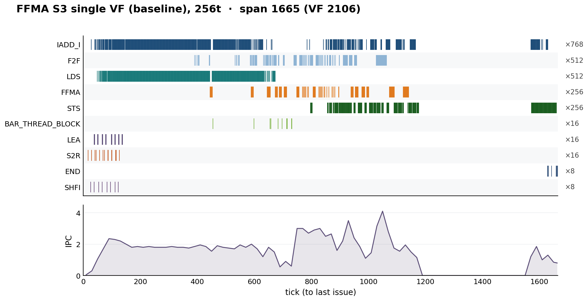
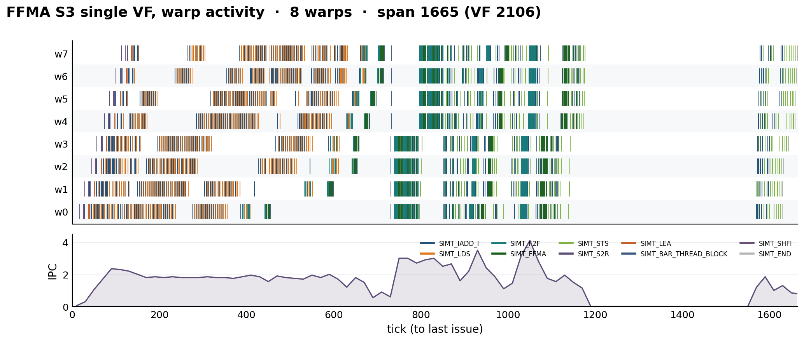
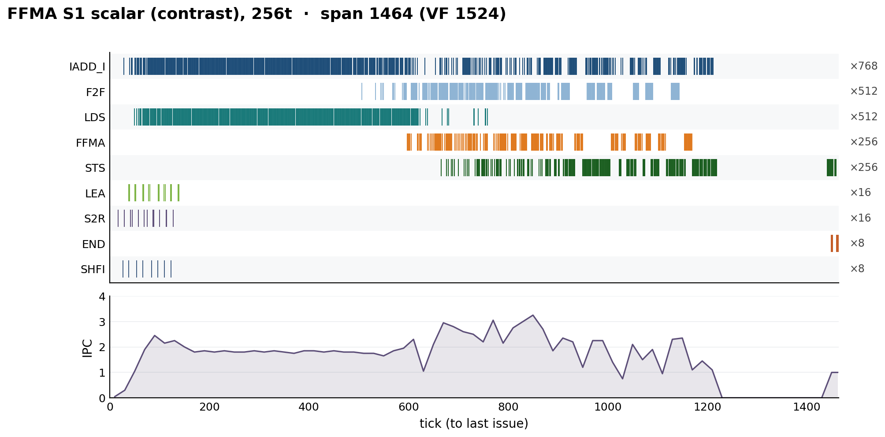
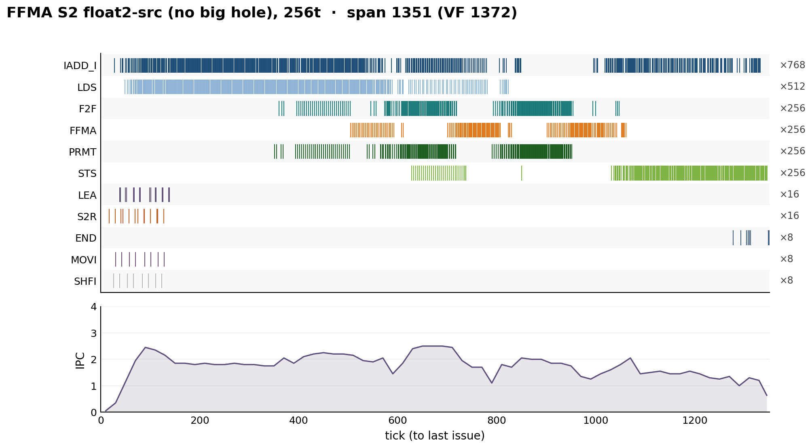
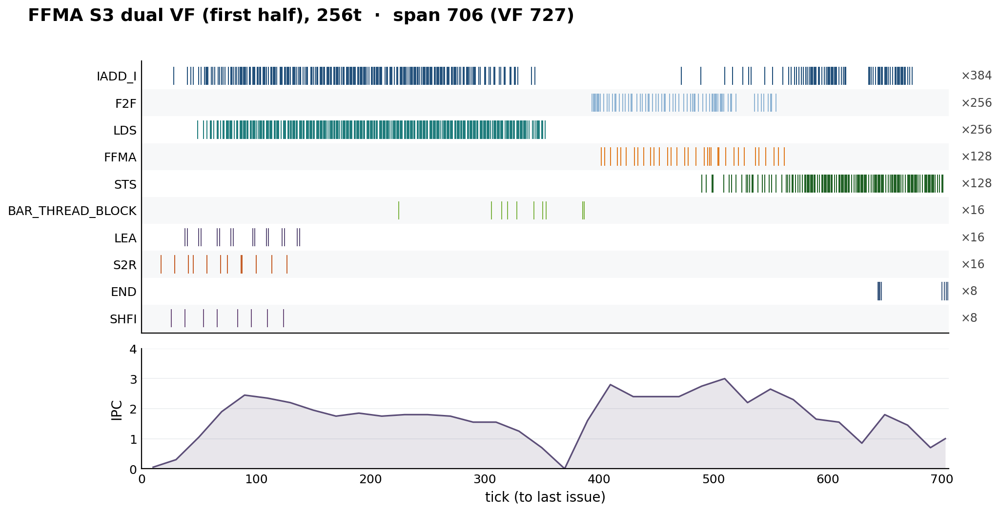
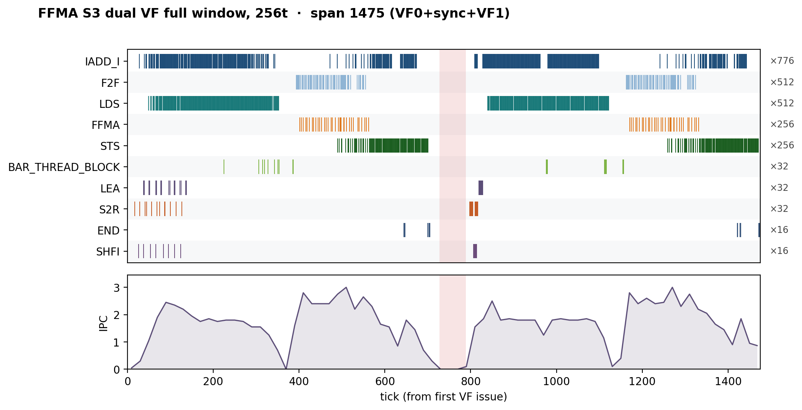

# I-cache miss — FFMA long-unroll 0-IPC hole (agent handoff)

Purpose: document the FFMA Schedule-3 empty/0-IPC strip, its cause, alternate mitigations, **how each option contaminates (or preserves) the simt-uarch analysis methodology**, and concrete fix examples the next agent can implement.

Stack: Ascend `dav-3510`, `npusim record`, core0/sub1. Busy = union of `[issue, completion)` (`../single-op/analyze.py`). Charts assume **one** `VF_SIMT` window (`tools/instr_vs_ipc.py`, `tools/warpchart.py`).

---

## 0. One-screen summary

| Item | Fact |
|---|---|
| Symptom | Long **0-IPC** blank in a VF (FFMA S3 microbench ~392 mid store-tail; fused dbl_buf ~550 **post-`END`** on first launch) |
| Nature | **All warps issue nothing** together (shared fetch / first-launch tax — not warp stagger) |
| Preferred fix for analysis | **Run the same VF body twice; measure the second launch only** (§2.1, §5 Fix G) |
| Why | First launch pays the gap; identical replay is clean (proven on `dbl_buf_twice`: 1646→**1070**, post-`END` 582→**22**) |
| Do **not** prefer | Split work across VFs as the headline fix, or “bounded unroll” as the primary methodology (may still help body size) |
| Do not | Cut warp count at fixed `N` (makes unroll larger) |

Artifacts:

- Baseline: `../single-op/pure_burst.asc` (`PURE_OP=FFMA`=2, `PURE_KIND=2`)
- Dual experiment: `../single-op/ffma_s3_dual_vf.asc`
- Traces: `../single-op/build/npusim_pure_ffmak2_t256/`, `…/npusim_ffma_s3_dual_vf_t256/`
- Charts: `plots/icache_ffma_*`

---

## 1. Cause

### 1.1 What you see

```text
VF-rel time →
w0..w7  [LDS|F2F|BAR|FFMA|STS … STS] ████████████ [IADD|STS … END]
                                      ↑ ~392 ticks ↑
                                      0 issues on EVERY warp
```





Confirm before blaming I-cache:

1. Longest **0-issue** run in the VF window is huge (S3: **392** @ VF-rel `[1178,1570)`).
2. **Every** warp has `n_in_gap == 0` (PC-order map from `warpchart.py`).
3. Last op before hole = `STS`; first after = `IADD_I` then more `STS` → stall on **store tail**.
4. **Not** the F2F S3 “gap”: there, other ops kept issuing and warps were phase-skewed. Barriers fixed F2F; they do **not** fix this (S3 already has barriers and has the worst hole).

### 1.2 Why we think I-stream / I-cache

| Evidence | Detail |
|---|---|
| Global silence | All warps stop together → shared fetch path, not per-warp data stall |
| Resume same loop | Continues STS tail at nearby PCs after the hole |
| Body size | FFMA `.aicore_binary` ~6.5KB / `instr.bin` ~2.1MB vs F2F ~4.7KB / 0.9MB — much larger I-footprint |
| Full unroll | S3 uses `#pragma unroll` on 32-iter preload, FFMA, and store → many distinct STS PCs |
| Dual halves body | Same total work, half unroll per VF → hole **vanishes** inside each VF |
| S2 contrast | Similar aicore bytes but denser STS PC packing → **no** big hole (layout matters) |

Size table:

| Case | `.aicore_binary` | `instr.bin` | max 0-IPC hole |
|---|---:|---:|---:|
| FFMA S1 | 6528 | ~2.11M | **221** (same STS-tail shape) |
| FFMA S2 | 6536 | ~2.12M | **17** |
| FFMA S3 | 6544 | ~2.12M | **392** |
| FFMA S3 dual | 6864 (2 bodies) | ~2.19M | **~32**/VF; inter-VF ~62 |

S3 is not uniquely larger than S1/S2; the hole tracks **long unrolled store streams** (S1/S3 layout), not a one-off size bump.





### 1.3 Root shape in source (baseline)

From `pure_burst.asc` FFMA S3 — three fully unrolled 32-trip loops in one VF:

```c
// PURE_KIND == 2, kPerThread == 32 @256t
#pragma unroll
for (int i = 0; i < kPerThread; ++i) {
  va[i] = __cvt_float(a[tid + i * kThreads]);
  vb[i] = __cvt_float(b[tid + i * kThreads]);
}
asc_syncthreads();
#pragma unroll
for (int i = 0; i < kPerThread; ++i) r[i] = va[i] * vb[i] + va[i];
asc_syncthreads();
#pragma unroll
for (int i = 0; i < kPerThread; ++i) dst[tid + i * kThreads] = r[i];  // store tail holes here
```

---

## 2. Alternate options (overview)

| Option | Idea | Hole? | Good for `simt-uarch` rate tables? |
|---|---|---|---|
| **G. Same body twice; use 2nd VF** | Redundant warm launch; **all rates/charts from VF[1]** | Proven: 2nd launch clean | **Yes — preferred** |
| **A. Bounded unroll / loop in one VF** | Shrink I-working set | May help | Secondary / optional |
| **B. Dual / multi VF (split work)** | Half work per launch | Proven gone | **No as headline** — diagnosis only |
| **C. More threads @ fixed N** | 512t → smaller unroll | Likely helps | Yes if one VF kept |
| **D. Fewer warps** | 128t → larger unroll | Likely **worse** | Do not use |
| **E. Barriers only** | Already in S3 | Still 392 | Irrelevant for this bug |
| **F. Denser store codegen** | S2-like compact STS PCs | Speculative | Yes if one VF |

### 2.1 Preferred methodology (updated)

**Do this for rate tables and charts:**

1. Launch the **same** VF body at least twice (redundant work is fine for measurement).
2. Discard VF[0] (cold / first-launch gap).
3. Take busy-union, IPC, and charts from **VF[1]** (and later identical launches if any).
4. If the case has two slabs with one VF each, the second slab launch is already the “warm” window — use it; estimate full-case VF as `2 × span(VF[1])`.

Evidence (`../schedules/runs/dbl_buf_twice-n2048-k8-t256`):

| Launch | Span | post-last → VF done |
|---|---:|---:|
| 1st ever | 1646 | **582** |
| 2nd (same body) | **1070** | **22** |
| 3rd / 4th | 1070 | 22 |

Bounded unroll / split-work dual VF remain useful *engineering* knobs, but they are **not** the analysis fix: the measurement rule is **always quote the second identical VF**.

---

## 3. Impact on analysis methodology (read this before picking a fix)

The uarch doc pipeline (`simt-uarch.md`, `pure_sweep.sh`) assumes for each schedule:

1. **One** `asc_vf_call` / one `VF_SIMT` window  
2. Fixed work `N=8192` (FFMA), `el/cyc = N / busy`  
3. Stock charts over that single window  
4. Schedules are comparable: same launch model, same accounting  

Anything that breaks (1) or changes the meaning of (2)/(3) must be footnoted or rejected as the **reported** S3 number.

### 3.1 Option A — bounded unroll, one VF

| Aspect | Impact |
|---|---|
| `analyze.py` busy / `n` / `el/cyc` | **Unchanged meaning.** Same `N`, one continuous FFMA population. Compare directly to S1/S2/old S3. |
| `span` | Still “first FFMA issue → last FFMA done” inside one VF — comparable. |
| Charts | Stock `instr_vs_ipc.py` / `warpchart.py` work. Counts should still show 256 FFMA, 256 STS, etc. |
| Purity | Still one pure multiply band (+ preload/store helpers). Loop control may add a few `IADD`/branch ops — note in bullets if visible on the chart. |
| Rate table | Drop-in replacement for FFMA S3 row. **Best methodology.** |
| Risk | Compiler may still fully unroll despite `#pragma unroll 4` — verify PC count / `.aicore_binary` shrank; if not, use an explicit outer runtime loop (§5). |

### 3.2 Option B — dual / multi VF (proven, bad as primary method)

Dual runs **two** VFs; each does **half** the els. Total FFMA issues stay 256 — compute is split, not doubled. But analysis impact is large:

| Aspect | Impact |
|---|---|
| Useful work | Same `N`, same `n=256` FFMA. |
| VF count | **2× launches** + inter-VF `PIPE_V` sync (~62 ticks quiet measured). |
| `analyze.py` busy | Still valid as whole-bin union (392 → **342**). Fair for throughput. |
| `analyze.py` span | **Inflated** — includes inter-VF quiet between last FFMA of VF0 and first of VF1. **Do not compare span to single-VF S3.** |
| Wall / last-issue span | Two windows + sync → looks slower end-to-end even when busy improves. |
| Stock charts | **Broken if used naively.** Tools take `next(VF_SIMT)` only → **VF0 only**: half op counts (128 FFMA), sync hole and VF1 omitted. Easy to mis-publish. |
| Full-window chart | Required (see `plots/icache_ffma_s3_dual_full.png`) + label clearly. |
| Warpchart | VF0-only or REFUSE if both VFs mashed into one window. |
| Purity / comparability | Mixes “FFMA rate” with launch/sync tax and duplicated prologues. Not the same experiment as S1/S2. |
| `simt-uarch.md` row | **Should not** replace S3 without a long footnote. Use as evidence that “smaller I-footprint removes the hole,” not as the official el/cyc. |

```text
Single:   [======== VF0 / all 32 els ========]
Dual:     [=== VF0 / 16 els ===]~~sync~~[=== VF1 / 16 els ===]
                 ↑ stock chart sees only this ↑
```

Measured dual vs single (reference):

| Metric | Single S3 | Dual | Notes for analysts |
|---|---:|---:|---|
| FFMA `n` | 256 | 256 | OK to compare |
| FFMA busy | 392 | 342 | OK to compare (whole-bin union) |
| el/cyc | 20.90 | ~23.95 | OK if derived from busy |
| Max 0-IPC in one VF | 392 | ~32 | Dual wins on pathology |
| Inter-VF quiet | — | ~62 | Dual-only cost |
| Stock chart | Full story | **Misleading (VF0 only)** | Must use full-window figure |

**Bottom line:** dual is a good **lab experiment**, a bad **headline methodology** for this repo’s rate tables.

### 3.3 Option C — more threads (e.g. 512t), one VF

| Aspect | Impact |
|---|---|
| Work | Keep `N=8192` → `kPerThread=16` → naturally half unroll vs 256t. |
| busy / el/cyc | Same formulas; **comparable in spirit** to other 512t rows if you already publish multi-thread sweeps. |
| Charts | Stock tools OK (one VF). |
| Caveat | Occupancy/regs/`__launch_bounds__` may change codegen; don’t mix 512t S3 into a table labeled @256t without a separate row. |
| vs dual | Same “smaller body” idea **without** second launch — better methodology than B. |

### 3.4 Option D — fewer warps

| Aspect | Impact |
|---|---|
| Unroll | `kPerThread` ↑ → **larger** I-stream → hole likely worse. |
| Analysis | Numbers may look even more polluted by stalls. |
| Verdict | Reject for this problem. |

### 3.5 What “affects analysis” means in practice

If the next agent lands dual (or any multi-VF) as the “fixed S3” in `simt-uarch.md` without care:

1. Readers compare el/cyc to S1/S2 thinking launch models match — they don’t.  
2. Auto chart regen via `pure_sweep.sh` publishes VF0-only plots that **hide** half the kernel.  
3. `span` / IPC-average over the stock window no longer match busy-union storytelling.  
4. Future agents will re-tune the wrong object (sync hole vs I-cache hole).

So: **fix with A (or C); keep B in this file as proof only.**

---

## 4. Dual launch calculation / chart protocol (if you must use B)

### 4.1 Numbers

```text
n      = total SIMT_FFMA across VF0+VF1          # still 256
busy   = union of all FFMA [issue,done)         # analyze.py whole bin
el/cyc = N / busy                               # 8192 / busy
span   = last_FFMA_done - first_FFMA_issue      # includes sync — do not rank by span
inter_vf_quiet = VF1_issue - VF0_done
hole_per_vf[i] = max 0-issue run inside VF i only
```

### 4.2 Charts

1. Stock tools → label **“dual VF0 only”** (not “dual result”).  
2. Custom full-window: first `VF_SIMT` issue → **last** `VF_SIMT` retire; shade `[VF0_done, VF1_issue)`.  
3. Never paste VF0-only into `simt-uarch.md` as the S3 illustration.

---

## 5. Solutions with examples

### Fix G (preferred) — same body twice; use 2nd VF for all numbers

**Goal:** keep the real kernel body; remove first-launch 0-IPC tax from **reported** rates and charts.

1. Run the identical VF (or slab VF) at least twice (redundant work OK for measurement).
2. Compute busy-union / IPC / el/cyc / B/cyc on **VF[1]** only.
3. Charts: plot **only** that second window (delete all-VF concatenated charts that embed the cold gap).
4. Multi-slab cases: full-case VF ≈ `2 × span(VF[1])`.

This is the methodology used in `SV3-theoretical.md` after 2026-11-12. Split-work dual VF and bounded unroll are optional engineering tools, not the analysis rule.

### Fix A (secondary) — one VF, bounded unroll

**Goal:** shrink I-working set so a *single* launch may also avoid the hole (engineering, not required for rate tables).

**Example A1 — capped unroll pragma** (minimal diff in `pure_burst.asc` FFMA S3):

```c
// Before: #pragma unroll  (full = 32 distinct iterations expanded)
// After:  hint a small factor; verify codegen actually reused a loop
#pragma unroll 4
for (int i = 0; i < kPerThread; ++i) {
  va[i] = __cvt_float(a[tid + i * kThreads]);
  vb[i] = __cvt_float(b[tid + i * kThreads]);
}
asc_syncthreads();
#pragma unroll 4
for (int i = 0; i < kPerThread; ++i) r[i] = va[i] * vb[i] + va[i];
asc_syncthreads();
#pragma unroll 4
for (int i = 0; i < kPerThread; ++i) dst[tid + i * kThreads] = r[i];
```

After build, check `.aicore_binary` size and unique SIMT PC count dropped vs 6544 / ~296. If the compiler ignored the cap, use A2.

**Example A2 — explicit chunk loop** (hard guarantee; still **one** `asc_vf_call`):

```c
constexpr int kChunk = 8;  // tune 4/8/16; 16 ≈ dual’s per-VF size
static_assert(kPerThread % kChunk == 0);

float va[kChunk], vb[kChunk], r[kChunk];
for (int base = 0; base < kPerThread; base += kChunk) {
#pragma unroll
  for (int i = 0; i < kChunk; ++i) {
    const int j = base + i;
    va[i] = __cvt_float(a[tid + j * kThreads]);
    vb[i] = __cvt_float(b[tid + j * kThreads]);
  }
  asc_syncthreads();  // keep if you still want a pure FFMA band per chunk
#pragma unroll
  for (int i = 0; i < kChunk; ++i) r[i] = va[i] * vb[i] + va[i];
  asc_syncthreads();
#pragma unroll
  for (int i = 0; i < kChunk; ++i) {
    const int j = base + i;
    dst[tid + j * kThreads] = r[i];
  }
}
```

Notes for A2:

- One VF → stock charts/analyze OK.  
- Barriers *per chunk* re-align warps often (good for purity) but add BAR traffic — mention on the chart.  
- Alternative: one preload loop (chunked) → one barrier → one FFMA loop (chunked) → one barrier → one store loop (chunked) to keep a single multiply band like today’s S3.

**Example A3 — chunk only the store tail** (hole is on STS; smallest behaviour change):

```c
// keep fully unrolled preload + FFMA + barriers as today
constexpr int kChunk = 8;
for (int base = 0; base < kPerThread; base += kChunk) {
#pragma unroll
  for (int i = 0; i < kChunk; ++i)
    dst[tid + (base + i) * kThreads] = r[base + i];
}
```

Try A3 first if you want the smallest patch; if the hole remains, the cold I-set includes preload/FFMA too → use A2.

**Verify A:**

```bash
./pure_one.sh 256 2 2 ffma 16384 SIMT_FFMA   # or dedicated .asc
# max 0-issue ≪ 392; all-warp silence gone
# analyze busy ≤ 392; stock charts show full 256 FFMA in one window
```

---

### Fix B — dual VF (diagnosis / fallback only)

Already implemented: `../single-op/ffma_s3_dual_vf.asc`.

```c
// Two templates, half els each; host launches both
asc_vf_call<simt_vf_phase<0>>(cce::dim3(kThreads), buf);
asc_sync_notify(PIPE_V, PIPE_V, ...);
asc_sync_wait(PIPE_V, PIPE_V, ...);
asc_vf_call<simt_vf_phase<1>>(cce::dim3(kThreads), buf);
```

Use to prove footprint theory or if A cannot win against the compiler. **Do not** make this the only S3 number in `simt-uarch.md` without §3.2 footnotes + full-window chart.





---

### Fix C — more threads, fixed N

```bash
# Same pure_burst S3 kind, 512 threads → kPerThread = 16
./pure_one.sh 512 2 2 ffma 16384 SIMT_FFMA
```

Report as its own @512t row (methodology OK). Do not overwrite the @256t S3 cell with a 512t number.

---

### Fix D — do not do this

```bash
./pure_one.sh 128 2 2 ffma 16384 SIMT_FFMA   # kPerThread=64 → larger body
```

---

## 6. Reproduction

```bash
cd benches/sv3/single-op
source /mnt/fluxdata/Ascend/cann_92b2/cann-9.2.0-beta.2/set_env.sh
# same TL_CAMODEL_LIB / LD_LIBRARY_PATH as pure_sweep.sh

./pure_one.sh 256 2 2 ffma 16384 SIMT_FFMA

PY=/home/onasismelchiorjeyakumar/workspace/tilelang/.venv/bin/python
$PY analyze.py $(find build/npusim_pure_ffmak2_t256 -name instr.bin | head -1) SIMT_FFMA
$PY analyze.py $(find build/npusim_ffma_s3_dual_vf_t256 -name instr.bin | head -1) SIMT_FFMA
```

Hole hunt: VF-rel issues on core0/sub1; longest zero-issue run; confirm all warps silent.

---

## 7. Definition of done

- [ ] All-warp store-tail 0-IPC hole removed or &lt;~30 ticks (excluding intentional `BAR`).
- [ ] Official FFMA S3 rate in `simt-uarch.md` comes from **one VF** (Fix A or C), comparable to S1/S2.
- [ ] If dual is cited, it is labeled diagnostic: whole-bin busy OK, span not ranked, **full-window** chart required, stock VF0-only chart not used as the result.
- [ ] Stock `instr_vs_ipc.py` / `warpchart.py` on the **reported** kernel show full op counts (256 FFMA @256t) in one window.
- [x] Rates/charts: **2nd identical VF** (`SV3-theoretical.md` + `plots/*_ub_k8.png`); Fix G preferred; bounded unroll optional.
