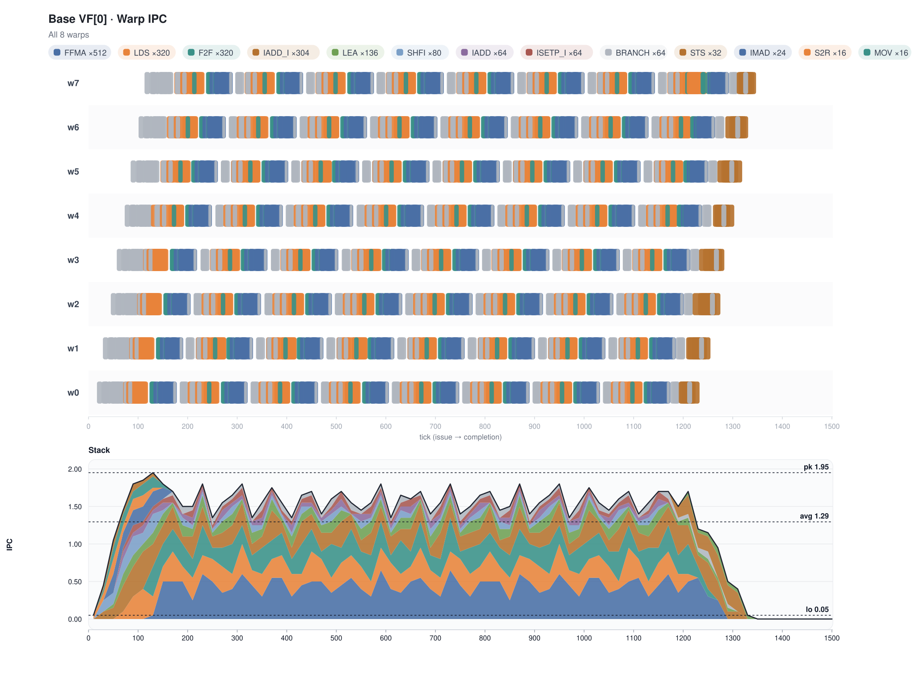
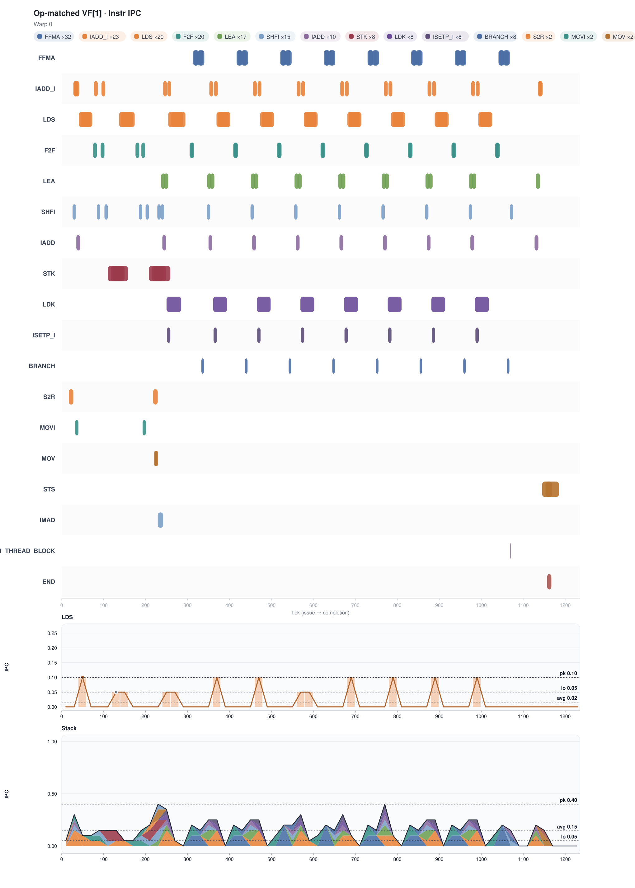
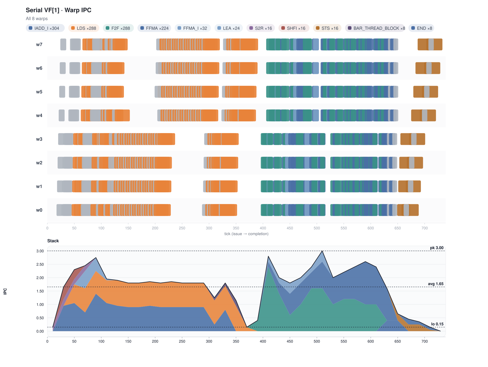
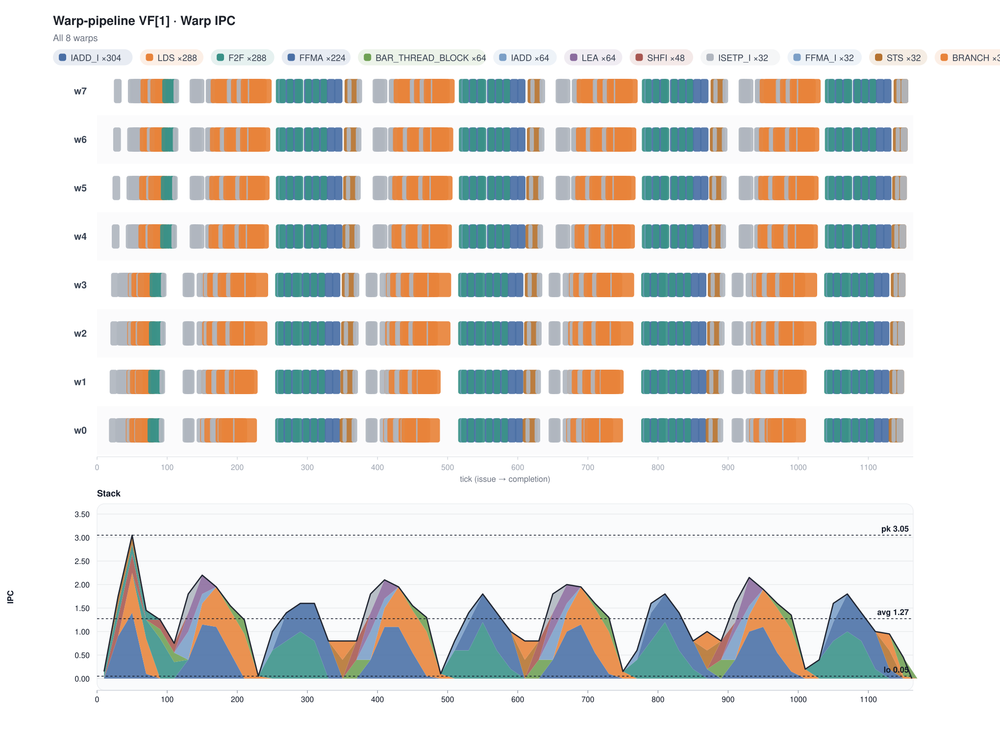
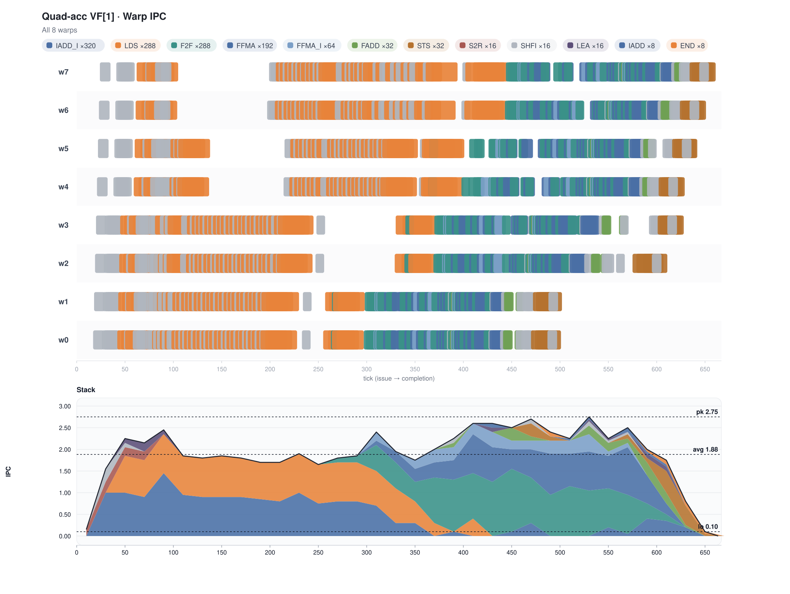
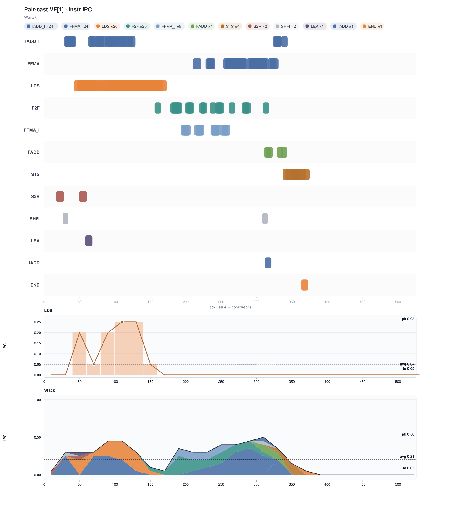
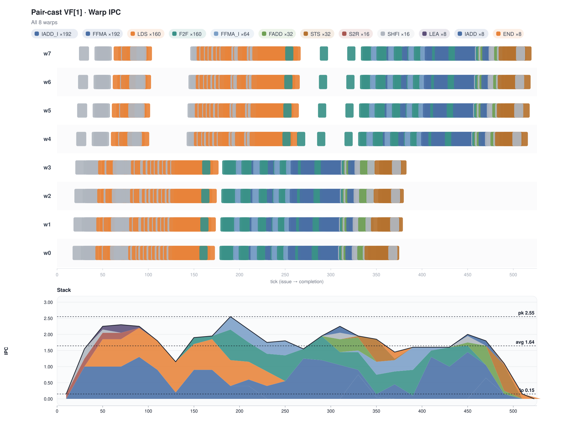

# SV3 theoretical

- Case: `N = 2048`, `K = 8`, buffer staging, 256 threads — `schedules/runs/ub-n2048-k8-t256`.
- Largest spill-free serial tile at 256 threads (`N = 4096` spills under serial → excluded).
- Loads with `LDS`. GM/`LDG` thread case at the same shape is not modeled.
- TileLang kernels: base, op-matched, serial, warp-pipeline, double-buffer, quad-buffer, quad-acc (`schedules/kernels.py`). Pair-cast (§3.8) is `lds-boost/src/probe_f2cast.py` arm `qset`.
- §2 rates and §4.2 `serialv4` probe are CCE/`.asc` microbenches — not TileLang.
- Dead-end variants and side measurements live in §5 (Exploration Notes) and `schedules/results/lds_improve.txt`.

**Accounting.** A kernel with two launches is written **VF[0] + VF[1]**. The sum is the decode length of each `VF_SIMT` window. The chart is the shorter window. Base has one window, so the chart is VF[0]. Operator rates in §3 and Table 9 divide the full-`N` work by the busy union summed over every launch. The LDS column of Table 3a is A bytes inside the chart window (32784 for base, which holds all of `N`; 16384 for a slab) divided by that window's LDS busy.

## 1. Kernel Flow

```text
GM ──MTE2──> UB  (A[k, n] fp16, x[k] fp16)   # outside the VF window
VF:
  LDS    fp16      : read column n of A, and x, from UB
  F2F    fp16→fp32 : convert
  FFMA   fp32      : acc += (float)A[k, n] * (float)x[k]
  STS    fp32      : write accumulators to out_ub
UB ──MTE3──> GM  (Out fp32)
```

`Out[n] = sum_k A[k, n] * x[k]`. `n` is the contiguous index.

**Table 1. Operator dtypes and bytes per warp issue.**

| Operator | Dtype | Bytes/elements per warp issue |
|---|---|---|
| LDS | fp16 | 64 B (scalar) / **128 B packed** |
| F2F | fp16 → fp32 | 32 values (scalar) / 64 packed |
| FFMA | fp32 | 32 products |
| STS | fp32 | 128 B |

## 2. Theoretical Estimation (from Single Instr)

- Rates from 256-thread single-op lines in `simt-uarch.md` (widest-issue schedule):
  - **LDS** Schedules 2–4 (typed/`uint32` pack) **81.11 B/cyc**
  - **F2F** Schedule 4 (packed barrier-aligned) **107.79 el/cyc** — 256t only; collapses at 1024t (30.65, `simt-uarch.md` §1024)
  - **FFMA** Schedule 3 (barrier-aligned) **20.90 el/cyc** (lower bound — §4.4; 26.01 @1024t)
  - **STS** Schedule 1 (coalesced) **92.30 B/cyc** (99.60 @1024t)
- Size-scaled pure LDS.b32 peaks higher (**76.38 @256 / 95.95 @512**); SoftLib ≈114 still open. GEMV theory uses the fp16 pack line (81.11).
- Work = unique algorithm traffic (`2·N·K + 2·K` LDS B, `N·K + K` F2F, `N·K` FFMA, `4·N` STS B).

**Table 2. 256-thread theoretical rates vs base case window.**

| Operator | Implementation | Theoretical, 256 t | Case window rate | Case / theory |
|---|---|---:|---:|---:|
| LDS | Schedules 2–4 — typed/`u32` pack | 81.11 B/cyc | 27.83 B/cyc | 0.34 |
| F2F | Schedule 4 — packed barrier-aligned | 107.79 el/cyc | 16.62 el/cyc | 0.15 |
| FFMA | Schedule 3 — barrier-aligned | 20.90 el/cyc | 14.11 el/cyc | 0.68 |
| STS | coalesced store | 92.30 B/cyc | 52.51 B/cyc | 0.57 |

**Table 3. Serial model at theoretical rates.**

| Operator | Theoretical | Work | Cycles |
|---|---|---:|---:|
| LDS | 81.11 B/cyc | 32784 B | 404.2 |
| F2F | 107.79 el/cyc | 16392 values | 152.1 |
| FFMA | 20.90 el/cyc | 16384 partials | 783.9 |
| STS | 92.30 B/cyc | 8192 B | 88.8 |
| **Sum (serial model)** | | | **1429.0** |
| **Measured VF (base)** | | | **1501** |

- Back-to-back at theory → **1429** cycles. Base is one window, **1501**, which is **1.05×** that sum.

## 3. Case Implementation

- Same shape for all: `N = 2048`, `K = 8`, 256 threads. `A` is `(K, N)`.
- Two launches are written **VF[0] + VF[1]**. The chart is the shorter window. Base has one window, so its chart is VF[0].
- Charts: **Instr IPC focused on LDS** (`charts/web`, `node render.js instr LDS`) and **Warp IPC**.
- Effective rates in the tables below divide the full-`N` work by the busy union summed over every launch.

**Table 3a. Current traces.** All `PASS`. Spills are zero except op-matched (64 `STK` + 64 `LDK` on each VF). LDS B/cyc is A bytes in the chart window ÷ that window's LDS busy: 32784 for base, 16384 for every slab launch.

| Schedule | VF[0] + VF[1] | el/cyc | Chart | LDS B/cyc |
|---|---|---:|---|---:|
| Base | 1501 | 1.36 | VF[0] | 27.83 |
| Op-matched | 1789 + 1234 = 3023 | 0.68 | VF[1] | 23.01 |
| Serial | 770 + 738 = 1508 | 1.36 | VF[1] | 47.35 |
| Warp-pipeline | 1299 + 1163 = 2462 | 0.83 | VF[1] | 34.79 |
| Double-buffer | 1730 + 1154 = 2884 | 0.71 | VF[1] | 29.47 |
| Quad-buffer | 1454 + 736 = 2190 | 0.94 | VF[1] | 45.51 |
| Quad-acc | 704 + 666 = 1370 | 1.49 | VF[1] | 40.55 |
| Pair-cast | 559 + 525 = 1084 | 1.89 | VF[1] | 72.82 |

### 3.1 Base

- `schedules/runs/ub-n2048-k8-t256` — default TileLang buffer GEMV.
- One VF, the whole `N` fits in UB: **VF[0] 1501**, IPC 1.31, `PASS`, no spills. `2048 / 1501 = 1.36` el/cyc, **1.05×** the serial model.

| Expectation (§2) | Base does |
|---|---|
| LDS pack ~81 B/cyc | 27.83 B/cyc on this window |
| F2F Schedule 4 ~108 el/cyc | 16.62 el/cyc |
| FFMA Schedule 3 ~21 el/cyc | 14.11 el/cyc |
| Coalesced STS burst | 52.51 B/cyc, busy 156 |




- Address adds track narrow loads; holes between load groups are the per-element `F2F→FFMA→STS` chain.
- First `LDS` ~90 cycles after VF start (pointer setup).
- Live state small (`acc[8]` + scalar `xk`) → no spills.

**Table 4. Base effective rates vs theoretical.**

| Operator | Work | Busy | Effective | Theoretical |
|---|---:|---:|---:|---:|
| LDS | 32784 B | 1178 | **27.83 B/cyc** | 81.11 B/cyc |
| F2F | 16392 el | 986 | **16.62 el/cyc** | 107.79 el/cyc |
| FFMA | 16384 el | 1161 | **14.11 el/cyc** | 20.90 el/cyc |
| STS | 8192 B | 156 | **52.51 B/cyc** | 92.30 B/cyc |

### 3.2 Op-matched (methodology)

- `schedules/runs/methodo-n2048-k8-t256` (`build_ub_methodo`).
- Aims for shapes TileLang can emit: convert `x` once (packed `__half22float2`), fragment accumulators, packed `float2` STS.
- Two slabs: **VF[0] 1789 + VF[1] 1234 = 3023**, 0.68 el/cyc, **2.12×** the model. Chart is VF[1], IPC 1.17. `PASS`.
- Each window has **64 STK + 64 LDK**.

Still not theory:

- `A` stays scalar (64 B `LDS`/el); packed LDS does not appear.
- **64 STK + 64 LDK per VF** from `acc[4]`+`xf[8]`. The sum 3023 is slower than base's 1501.




- STS busy is 84 on each VF (168 across both). Spills still make the sum slower than base.

**Table 5. Op-matched effective rates vs theoretical (busy summed over both VFs).**

| Operator | Work | Busy (VF[0]+VF[1]) | Effective | Theoretical |
|---|---:|---:|---:|---:|
| LDS | 32784 B | 1766 | **18.56 B/cyc** | 81.11 B/cyc |
| F2F | 16392 el | 1114 | **14.71 el/cyc** | 107.79 el/cyc |
| FFMA | 16384 el | 1233 | **13.29 el/cyc** | 20.90 el/cyc |
| STS | 8192 B | 168 | **48.76 B/cyc** | 92.30 B/cyc |

### 3.3 Serial

- `schedules/runs/serial-n2048-k8-t256` (`build_ub_serial`).
- Per slab: load+convert into `af[32]`+`xf[8]`, then multiply, then store.
- Live **44 fp32/thread** — largest spill-free 256t tile.
- Two slabs: **VF[0] 770 + VF[1] 738 = 1508**, 1.36 el/cyc, IPC 1.66 on the chart (VF[1]), `PASS`, **no spills**. **1.06×** the model.




0-IPC stretches (structural, not cold I-cache):

- **LDS→F2F load-return drain** (~150–190 ticks once per launch): converts wait on UB returns (~1/8 ticks).
- **Small holes inside the load band** (~7–52 ticks): same return-queue back-pressure.
- Inter-slab MTE2 (~760 ticks) is outside this VF window.

Other notes:

- Stages read cleanly: dense `LDS`/`F2F` → `FFMA` → `STS`.
- F2F effective **35.63** el/cyc across both windows (below Schedule 4 **107.79**).
- FFMA busy summed over both windows is **456** for `SIMT_FFMA` plus **170** for `SIMT_FFMA_I`. The FFMA column below counts `SIMT_FFMA` only.

**Table 6. Serial effective rates vs theoretical (busy summed over both VFs).**

| Operator | Work | Busy (VF[0]+VF[1]) | Effective | Theoretical |
|---|---:|---:|---:|---:|
| LDS | 32784 B | 725 | **45.22 B/cyc** | 81.11 B/cyc |
| F2F | 16392 el | 460 | **35.63 el/cyc** | 107.79 el/cyc |
| FFMA | 16384 el | 456 | **35.93 el/cyc** | 20.90 el/cyc |
| STS | 8192 B | 168 | **48.76 B/cyc** | 92.30 B/cyc |

**Table 7. Serial VF against the model.**

| Reference | Cycles | Measured 770 + 738 / reference |
|---|---:|---:|
| Serial model sum (Table 3) | 1429 | **1.06×** |
| Base VF | 1501 | **1.00× of base** |

### 3.4 Warp-pipeline

- Same stage order as serial, but per **strip** of `threads` rows (not whole-slab barrier between stages).
- `schedules/runs/warp_pipe-n2048-k8-t256` (`build_ub_warp_pipe`).
- Two slabs: **VF[0] 1299 + VF[1] 1163 = 2462**, 0.83 el/cyc, IPC 1.30 on VF[1], `PASS`, **no spills**. **1.72×** the model.
- Slower than serial (1508) on this trace. The chart is VF[1].




- Stages repeat per strip (4 strips × 2 launches).
- LDS effective **32.27 B/cyc** across both windows, under serial's 45.22. Strip staging does not beat the whole-slab serial on this trace.

**Table 6b. Warp-pipeline effective rates vs theoretical (busy summed over both VFs).**

| Operator | Work | Busy (VF[0]+VF[1]) | Effective | Theoretical |
|---|---:|---:|---:|---:|
| LDS | 32784 B | 1016 | **32.27 B/cyc** | 81.11 B/cyc |
| F2F | 16392 el | 753 | **21.77 el/cyc** | 107.79 el/cyc |
| FFMA | 16384 el | 672 | **24.38 el/cyc** | 20.90 el/cyc |
| STS | 8192 B | 224 | **36.57 B/cyc** | 92.30 B/cyc |

**Table 7b. Warp-pipeline VF against the model.**

| Reference | Cycles | Measured 1299 + 1163 / reference |
|---|---:|---:|
| Serial model sum (Table 3) | 1429 | **1.72×** |
| Serial VF | 1508 | **1.63× of serial (slower)** |
| Base VF | 1501 | **1.64× of base** |

### 3.5 Double-buffer

- Prefetch strip `t+1` into `af0`/`af1` while multiplying+storing strip `t` — overlaps in-flight LDS with FFMA.
- `schedules/runs/dbl_buf-n2048-k8-t256` (`build_ub_dbl_buf`).
- **VF[0] 1730 + VF[1] 1154 = 2884**, 0.71 el/cyc, IPC 1.83 on VF[1], `PASS`, no spills. **2.02×** the model.
- Slower than serial (1508) and warp-pipeline (2462) on this trace. The chart is the shorter window, VF[1]. VF[0] is the cold launch.


Two kinds of IPC = 0:

- **Cold first-launch blank** — removed from this chart (VF[1] only).
- **Structural `LDS→F2F` drains** — still visible (~280–350, ~620–680, ~780–860): converts wait on that strip’s own load returns. Overlap hides some of it, not all.

**Table 6c. Double-buffer effective rates vs theoretical (busy summed over both VFs).**

| Operator | Work | Busy (VF[0]+VF[1]) | Effective | Theoretical |
|---|---:|---:|---:|---:|
| LDS | 32784 B | 1157 | **28.34 B/cyc** | 81.11 B/cyc |
| F2F | 16392 el | 587 | **27.93 el/cyc** | 107.79 el/cyc |
| FFMA | 16384 el | 1146 | **14.30 el/cyc** | 20.90 el/cyc |
| STS | 8192 B | 228 | **35.93 B/cyc** | 92.30 B/cyc |

- The cold window is the 1730. The shorter window is 1154. Sum 2884 is still well above 1429.

### 3.6 Quad-buffer

- Prefetch strips `t+1..t+3` into `af0..af3` before multiplying+storing strip `t` — the whole slab's `A` loads issue as **one contiguous band** instead of dbl-buf's three latency-drained bursts.
- `schedules/runs/dbl_buf_quad-n2048-k8-t256` (`build_ub_dbl_buf_quad`, `schedules/kernels.py`).
- Why: dbl-buf keeps only **2 `uint2` loads in flight per thread** (one strip ahead). The VF[1] trace shows 3 LDS bursts ([42–262] [534–600] [720–760], relative to window start) with **~270-tick 0-LDS holes**; issue rate inside a burst collapses 0.85 → 0.25/cyc while per-issue latency inflates 27 → 98 ticks (return-queue saturation at 8 warps). Quad puts **8 `uint2` in flight per thread**.
- Shape (`N=2048, K=8, t=256`): slab 1024 → **4 strips**; prolog loads strips 0–2, the single steady step prefetches strip 3 while strip 0 is multiplied+stored, epilog multiplies+stores strips 1–3.
- Two slabs: **VF[0] 1454 + VF[1] 736 = 2190**, 0.94 el/cyc, IPC 1.71 on VF[1], `PASS`, no spills. **1.53×** the model.
- The chart is VF[1]. VF[0] is still the cold launch (1454 vs 736).


- On this trace the sum is 2190 against double-buffer's 2884. The chart window's LDS band is **45.51 B/cyc**. Across both windows the LDS rate is **43.31 B/cyc**.

**Table 6d. Quad-buffer effective rates vs theoretical (busy summed over both VFs).**

| Operator | Work | Busy (VF[0]+VF[1]) | Effective | Theoretical |
|---|---:|---:|---:|---:|
| LDS | 32784 B | 757 | **43.31 B/cyc** | 81.11 B/cyc |
| F2F | 16392 el | 442 | **37.09 el/cyc** | 107.79 el/cyc |
| FFMA | 16384 el | 468 | **35.01 el/cyc** | 20.90 el/cyc |
| STS | 8192 B | 118 | **69.42 B/cyc** | 92.30 B/cyc |

**Table 7c. Quad-buffer VF against the model.**

| Reference | Cycles | Measured 1454 + 736 / reference |
|---|---:|---:|
| Serial model sum (Table 3) | 1429 | **1.53×** |
| Serial VF | 1508 | **1.45× of serial (slower)** |
| Warp-pipe VF | 2462 | **0.89× of warp-pipe (faster)** |
| Dbl-buf VF | 2884 | **0.76× of dbl-buf (faster)** |

### 3.7 Quad-acc

- Same quad strip buffering as §3.6, but the FFMA chains are **split across independent accumulators** and the control flow is **straight-line** (no `t`-loop, no `% 4` modular branches — specialized to the `n_strips == 4` shape).
- `schedules/runs/quad_acc-n2048-k8-t256-nosync` (`build_ub_quad_acc`, measured with `tl.disable_thread_storage_sync` — see §5 for the barrier lever).
- Why: after barrier removal the steady VF is still ~840–850; the remaining tail is an **8-deep serial FFMA dependency** per strip (`acc += af[n,k]*xf[k]`, `k=0..7`). Strips are mutually independent, so their chains can interleave. Even/odd indexing inside one `T.Parallel` body is rejected by the Ascend structural-equal check; the compiling workaround is to **split fragments into 4-col halves** (`af0a`/`af0b`, …) so each buffer sees one index expression per body.
- Shape: prolog loads strips 0–2 (halved fragments); steady prefetches strip 3 then macs strip 0 on 2 chains (depth 4); epilog advances **6 chains** (strips 1–3 × 2 halves) in one `k` loop, then stores.
- Two slabs: **VF[0] 704 + VF[1] 666 = 1370**, 1.49 el/cyc, IPC 1.93 on VF[1], `PASS`, no spills, no `BAR_THREAD_BLOCK`. **0.96×** the model. Pair-cast (§3.8) is shorter.
- The chart is VF[1], the shorter window. The cold gap is 704 vs 666, much smaller than quad-buffer's 1454 vs 736.




- Chart-window LDS band is **40.55 B/cyc**. Across both windows it is **40.98 B/cyc**. Pair-cast (§3.8) is the shorter sum, **559 + 525 = 1084**, and its chart-window load band is **72.82 B/cyc**.
- Vs the barrier-free quad on the current traces: **VF[0] 1442 + VF[1] 669 = 2111**. Quad-acc's 1370 is the collapsed cold window, not a higher load band.

**Table 6e. Quad-acc effective rates vs theoretical (busy summed over both VFs).**

| Operator | Work | Busy (VF[0]+VF[1]) | Effective | Theoretical |
|---|---:|---:|---:|---:|
| LDS | 32784 B | 800 | **40.98 B/cyc** | 81.11 B/cyc |
| F2F | 16392 el | 624 | **26.27 el/cyc** | 107.79 el/cyc |
| FFMA | 16384 el | 588 | **27.86 el/cyc** | 20.90 el/cyc |
| STS | 8192 B | 251 | **32.64 B/cyc** | 92.30 B/cyc |

**Table 7d. Quad-acc VF against the model.**

| Reference | Cycles | Measured 704 + 666 / reference |
|---|---:|---:|
| Serial model sum (Table 3) | 1429 | **0.96×** |
| Serial VF | 1508 | **0.91× of serial (faster)** |
| Warp-pipe VF | 2462 | **0.56× of warp-pipe (faster)** |
| Dbl-buf VF | 2884 | **0.48× of dbl-buf (faster)** |
| Quad-buf VF | 2190 | **0.63× of quad-buf (faster)** |

### 3.8 Pair-cast (`float16x2`)

- Same `N=2048`, `K=8`, 256 threads. `A` is stored `A[k, n]` and packed to `uint32`: word `(c, n)` is the fp16 pair `(A[2c, n], A[2c+1, n])`. Lane stride is 4 B.
- The schedule is the quad-acc shape on that packed word. Four strips. Each strip keeps two accumulators, one per lane of the pair, so eight chains update in the same `k` step. Loads of all four strips are issued before the converts. `tl.disable_thread_storage_sync` is on, so there is no block barrier in the load phase.
- Why this spelling: `codegen_ascend.cc` `PrintVectorizedCast` emits `__half22float2` only when the cast source has 2, 4, or 8 `float16` lanes. A scalar `uint16` pun (`*(half *)(&v_)`) does not take that path, and bisheng then spills each half (§9 of `../lds-boost/lds_performance.md`).
- Source: `../lds-boost/src/probe_f2cast.py` arm `qset`. Trace: `../lds-boost/runs/probe-f2-qset-nosync-n2048-k8-t256/` (`npusim_20261120145601_launch_flip.py`).
- **VF[0] 559 + VF[1] 525 = 1084**, **1.89 el/cyc**, IPC 1.70 on VF[1], `PASS`, **0 STK / 0 LDK**, **0** `BAR_THREAD_BLOCK`. **0.76×** the serial model. The chart is VF[1].
- The one-accumulator serial spelling of this cast (`serial`, `npusim_20261120135147`) was **722 + 707 = 1429**. The row loop (`v_ramp`) was **1892**.





- Warp 0 of VF[1] issues its 20 loads from cycle 42 to 145, then 20 converts from 156, then the multiplies. 21 of the 24 `FFMA` issues sit in one block (253–319). One warp issues **111** instructions. **0 STK / 0 LDK.**
- Chart-window LDS band is **72.82 B/cyc**. Across both windows it is **59.82 B/cyc**.
- This is the shortest sum in the ladder. Quad-acc is **704 + 666 = 1370**.

**Table 6f. Pair-cast effective rates vs theoretical (both windows).**

Work is the same unique traffic as Table 3 (`2·N·K+2·K` LDS bytes). Busy is the union summed over both windows.

| Operator | Work | Busy (VF[0]+VF[1]) | Effective | Theoretical |
|---|---:|---:|---:|---:|
| LDS | 32784 B | 548 | **59.82 B/cyc** | 81.11 B/cyc |
| F2F | 16392 el | 598 | **27.41 el/cyc** | 107.79 el/cyc |
| FFMA | 16384 el | 542 | **30.23 el/cyc** | 20.90 el/cyc |
| STS | 8192 B | 226 | **36.25 B/cyc** | 92.30 B/cyc |

**Table 7e. Pair-cast against the current measurements.**

| Reference | Cycles | 559 + 525 = 1084 against it |
|---|---:|---:|
| Serial model sum (Table 3) | 1429 | **0.76×** |
| Quad-acc, VF[1] | 666 | 525 is **0.79×** (faster on the shorter window) |
| Quad-acc, VF[0] + VF[1] | 1370 | **0.79×** (faster end to end) |
| Pair-cast serial, both windows | 1429 | **0.76×** (faster) |
| Row-loop pair-cast, both windows | 1892 | **0.57×** (faster) |
| Pun V3, both windows | 4424 | **0.25×** (faster) |

### 3.9 Conclusion

**Table 8. Methods vs the theoretical serial sum.**

`el/cyc` = `2048 / (VF[0] + VF[1])`. Base has only VF[0].

`Instr/warp` is how many instructions one warp issues in the chart window. All 8 warps issue the same number. The model row has no instruction stream.

| Method | VF[0] + VF[1] | el/cyc | Instr/warp | vs 1429 |
|---|---|---:|---:|---:|
| Theoretical serial sum | 1429 | **1.43** | — | 1.00× |
| Base (default TileLang) | 1501 | 1.36 | 246 | 1.05× |
| Op-matched | 1789 + 1234 = 3023 | 0.68 | 180 | 2.12× |
| Serial schedule | 770 + 738 = 1508 | 1.36 | 153 | 1.06× |
| Warp-pipeline | 1299 + 1163 = 2462 | 0.83 | 188 | 1.72× |
| Double-buffer | 1730 + 1154 = 2884 | 0.71 | 263 | 2.02× |
| Quad-buffer | 1454 + 736 = 2190 | 0.94 | 157 | 1.53× |
| Quad-acc | 704 + 666 = 1370 | 1.49 | 160 | 0.96× |
| **Pair-cast (`float16x2`)** | **559 + 525 = 1084** | **1.89** | **111** | **0.76×** |

**Table 9. Per-operator effective rate by method.** Full-`N` work ÷ busy union summed over every launch.

| Operator | Theoretical (256 t) | Base | Op-matched | Serial | Warp-pipe | Dbl-buf | Quad-buf | Quad-acc | Pair-cast |
|---|---:|---:|---:|---:|---:|---:|---:|---:|---:|
| LDS (B/cyc) | 81.11 | 27.83 | 18.56 | 45.22 | 32.27 | 28.34 | 43.31 | 40.98 | **59.82** |
| F2F (el/cyc) | 107.79 | 16.62 | 14.71 | 35.63 | 21.77 | 27.93 | **37.09** | 26.27 | 27.41 |
| FFMA (el/cyc) | 20.90 | 14.11 | 13.29 | **35.93** | 24.38 | 14.30 | 35.01 | 27.86 | 30.23 |
| STS (B/cyc) | 92.30 | 52.51 | 48.76 | 48.76 | 36.57 | 35.93 | **69.42** | 32.64 | 36.25 |

Read Table 8 by the sum, not by the order of the rows. The rows are the order we tried things (§5). Shorter is better.

- **Pair-cast** is the shortest: **559 + 525 = 1084**, **1.89 el/cyc**, **0.76×** the model. Best LDS band in Table 9 (**59.82 B/cyc**; the chart window alone is **72.82**). One load phase, then the converts, then one multiply block. Eight accumulators, no block barrier, **111** instructions per warp.
- **Quad-acc** is next: **704 + 666 = 1370**, **1.49 el/cyc**, **0.96×**. Same phase shape, unpacked loads, **160** instructions per warp, chart-window LDS **40.55 B/cyc**.
- **Base** (**1501**) and **serial** (**770 + 738 = 1508**) are close to each other and to the model. Serial has the highest FFMA rate in Table 9 (**35.93**). Pair-cast’s **30.23** is that multiply block overlapping the converts, not fewer products.
- The strip pipelines are slower than serial on these traces. **Quad-buffer** is **1454 + 736 = 2190** (1.53×, 0.94 el/cyc). **Warp-pipeline** is **1299 + 1163 = 2462** (1.72×, 0.83 el/cyc). **Double-buffer** is **1730 + 1154 = 2884** (2.02×, 0.71 el/cyc). Each still has a long cold VF[0].
- **Op-matched** is the longest (**1789 + 1234 = 3023**) because each VF spills **64 STK + 64 LDK**.
- The load band is still under the 79.92 CCE loads-only line. F2F inside a fused kernel tops out at **37.09 el/cyc** (quad-buffer). Pair-cast’s 27.41 is lower because the convert stays busy across the multiply. The 107.79 line is a convert-only microbench (§4.2).

## 4. Limitations

These are the constraints the path in §5 ran into. The cycle counts are the current traces.

### 4.1 The register file ended the first packed attempt

- Op-matched keeps `acc[4]` and `xf[8]` live and spills: **64 STK + 64 LDK on each VF**. The sum is **1789 + 1234 = 3023**, slower than base.
- Serial stages one slab, about **44 fp32/thread** at `N=2048`, and does not spill. That is why §5.2 is the next step. At `N=4096` the same schedule goes to about **80 live** and **1152 spill pairs**, VF 15394 (`schedules/results/serial_spill_sweep.txt`).
- Warp-pipeline, double-buffer, quad-buffer, quad-acc, and pair-cast keep strip-sized fragments. None of them spill at this `N=2048` shape.

### 4.2 A dedicated convert window does not appear inside the fused kernel

- Schedule 4’s **107.79 el/cyc** is a convert-only microbench.
- An older hand-patched serial (`schedules/runs/serialv4-n2048-k8-t256`) split the load, the convert, and the multiply with barriers. F2F busy barely moved (348 → 346) and that kernel’s VF went **2960 → 2994**. Those windows are not the current serial trace (**770 + 738 = 1508**).
- On the current fused kernels the highest F2F rate is quad-buffer at **37.09 el/cyc**. The barrier lines threads up. It does not make the fast and slow issue groups share one convert burst.

### 4.3 The DSL has no thread barrier of its own

- `asc_syncthreads()` is inserted by the compiler (`codegen_ascend.cc`). There is no `T.` intrinsic for it.
- `T.ascend_pipe_barrier("PIPE_V")` is a pipe hazard, not a block barrier.
- Dropping the block barrier is the opt-in flag `tl.disable_thread_storage_sync` (§5.5). It is safe here because each thread writes only its own `out_ub` slots.

### 4.4 The compiler can convert a packed word; it does not have a packed FFMA

- `T.Cast("float32x2", T.reinterpret(word, "float16x2"))` lowers to `__half22float2`, one F2F for both halves (§3.8). A scalar `uint16` pun of the same bits spills.
- The multiply after that cast is still scalar `SIMT_FFMA`. Serial’s FFMA rate is **35.93 el/cyc**. Pair-cast’s is **30.23**. Both sit above the 20.90 microbench line because the busy union is shorter than a walk of one product after another.
- The 20.90 line is a lower bound. Re-isolating that microbench so it sits above 35.93 is still open.

### 4.5 The load is wider, and it is still not the pure-LDS line

- A typed pack reaches **81.11 B/cyc** in a load-only microbench. About one `IADD_I` per load holds the issue rate near 0.63. SoftLib ≈114 is still open.
- Pair-cast is the packed GEMV layout: `A[k, n]`, 4 B stride. The chart window is **72.82 B/cyc**. Both windows together are **59.82** (Table 9). The gap to the 79.92 CCE loads-only line is the convert and the multiply in the same VF.
- **~28.6 B/cyc** is the older `A[n, k]` stride note in `schedules/results/lds_improve.txt`. It is not the band of the traces in §3.

### 4.6 A faster kernel can show a lower per-operator rate

- The rates in Table 9 are full-`N` work divided by the time that opcode is busy. When two opcodes overlap, each busy union gets longer and the rate falls, even though the VF gets shorter.
- That is why pair-cast’s F2F rate is **27.41** while quad-buffer’s is **37.09**. Pair-cast’s converts sit inside the multiply block. Quad-buffer’s converts are closer to their own phase, so the busy union is shorter and the rate looks higher. Quad-buffer’s sum is **2190**. Pair-cast’s is **1084**.

## 5. The path

Cycle counts here are the current traces, written **VF[0] + VF[1]**. `schedules/results/second_vf.txt` is the earlier log (serial **2 × 1472 = 2944**). It is not the source of the numbers below.

### 5.1 Base, then a packed attempt that spilled

- Base is one window over all of `N`: **1501**, **1.05×** the 1429-cycle model, no spills. The inner loop is still one element at a time, so the load band is **27.83 B/cyc** against an 81.11 line.
- Op-matched tried a packed convert, fragment accumulators, and a packed store. The accumulators and the copied `x` stay live together and spill **64 STK + 64 LDK on each VF**. Sum **1789 + 1234 = 3023**.
- The wall was the live set, not the opcode mix. The next schedule stages the work so only one slab is live.

### 5.2 Serial staging

- One slab is loaded and converted, then multiplied, then stored. About 44 fp32 per thread, no spills.
- **VF[0] 770 + VF[1] 738 = 1508**, **1.06×** the model. This is the first schedule that sits on the model rather than several times above it.
- The chart (VF[1]) is three phases: loads, then a wait for those loads to return, then converts and multiplies. That wait is the hole the strip schedules tried to cover.

### 5.3 Strip pipelines

- Warp-pipeline repeats the serial phases on one strip of 256 outputs, so a later strip can start before the slab is finished. **VF[0] 1299 + VF[1] 1163 = 2462**, **1.72×**. Slower than serial.
- Double-buffer keeps the next strip’s loads in flight during the current strip’s multiply. **VF[0] 1730 + VF[1] 1154 = 2884**, **2.02×**. The cold window is most of the extra cost: 1730 against 1154. `dbl_buf_twice` is four windows, **1211 + 1174 + 1174 + 1174**.
- Quad-buffer holds four strips so the slab’s loads can issue as one band. **VF[0] 1454 + VF[1] 736 = 2190**, **1.53×**. The chart window’s LDS band is **45.51 B/cyc** (both windows **43.31**). The cold window is still 1454 against 736.
- On these traces none of the three beat serial’s 1508. The loads are no longer long enough for the extra buffering to pay for the cold first window and the block barrier.

### 5.4 The barrier

- The compiler inserts `asc_syncthreads()` between the staged fragments. Quad-buffer has 8 of them on a window (one per warp). Double-buffer has 24.
- `--nosync` (`tl.disable_thread_storage_sync`) drops them. Stock quad-buffer is **1454 + 736 = 2190**. The same kernel without the barrier is **1442 + 669 = 2111**. The shorter window moves 736 → 669. Both pass. The sum is still well above serial.

### 5.5 Reordering the phases

The barrier-free quad still did its loads, then its converts. Two attempts to overlap those phases:

| Variant | Idea | VF[0] + VF[1] | Verdict |
|---|---|---|---|
| stock quad-nosync | — | 1442 + 669 = 2111 | baseline |
| `quad_reord` | multiply and store strip `t` first, prefetch last | 1437 + 725 = 2162 | slower |
| `quad_ilv` | convert a chunk of the next strip, then multiply a chunk of the current one | 1440 + 669 = 2109 | same sum as the baseline |
| `quad_acc` | several independent multiply chains, straight-line body, no barrier | **704 + 666 = 1370** | cold window collapses |

- Moving the convert earlier does not shorten a window whose sum is already set by the cold launch and the multiply chain.
- Quad-acc is the one that changes the sum. The body is straight-line, so VF[0] is 704 and VF[1] is 666 instead of 1442 and 669. Several accumulators are in flight, so the next multiply does not wait on a single chain. This is the first schedule in the ladder that is shorter than serial.

### 5.6 Pair-cast

- The same phase shape, with each loaded word holding two fp16 values. `T.Cast("float32x2", T.reinterpret(word, "float16x2"))` is what makes the compiler emit `__half22float2`. A scalar pun of those bits spills (§9 of `../lds-boost/lds_performance.md`).
- Three spellings, same math. The row loop (`v_ramp`) is one accumulator reissued per row: sum **1892**. The whole-slab serial arm is one accumulator after all the loads: **722 + 707 = 1429**, with a barrier in the load phase and the multiplies in short bursts. The published kernel (`qset`) is four strips and eight accumulators, barrier off.
- **VF[0] 559 + VF[1] 525 = 1084**, **1.89 el/cyc**, **0.76×** the model. No spills, no block barrier. Chart-window LDS band **72.82 B/cyc** (both windows **59.82**). One warp issues **111** instructions. This is 286 cycles under quad-acc’s 1370.
- The chart on VF[1] is one load band (cycles 42–145 on warp 0), converts from 156, and one multiply block. That is the schedule §3.8 records.

### 5.7 Where the result stands

- Shortest sum: pair-cast, **559 + 525 = 1084**.
- Next: quad-acc, **704 + 666 = 1370**. The unpacked version of the same phase shape.
- Serial, **1508**, is the reference the strip pipelines did not beat.
- Still open: the load band versus 79.92, a packed multiply (§4.4), and the convert-only rate of 107.79 (§4.2).

### 5.8 Exploration flow

```text
                    [Base 1501]
                         |
                    one element at a time
                         |
                         v
              [Op-matched 1789+1234]
                    spills 64 STK + 64 LDK per VF
                         |
                         v
              [Serial 770+738 = 1508]
                    near the 1429 model
                         |
           +-------------+--------------+
           |                            |
           v                            v
 [Warp-pipe 1299+1163]        [Double-buffer 1730+1154]
           |                            |
           +-------------+--------------+
                         |
                         v
              [Quad-buffer 1454+736 = 2190]
                    still slower than serial
                         |
              drop the barrier: 1442+669 = 2111
              reorder / interleave stay near 2111
                         |
                         v
              [Quad-acc 704+666 = 1370]
                    straight-line, several accumulators
                    cold window collapses
                         |
                         v
              [Pair-cast 559+525 = 1084]
                    same shape, packed word, 8 accumulators
                    chart LDS band 72.82 B/cyc
                         |
                         v
              [open: 72.82 toward 79.92,
               and a packed multiply]
```


## Appendix A. Sources and provenance

### A.1 Environment

| Item | Value |
|---|---|
| Device model | Ascend950PR, npusim, SoC `Ascend950PR_9599` |
| SIMT arch | `dav-3510`, warp = 32, 256 threads = 8 warps |
| Device compiler | bisheng (clang 15.0.5), `--npu-arch=dav-3510` |
| CANN | `cann-9.2.0-beta.2` |
| TileLang | `workspace/tilelang` |

### A.2 Where every number comes from

Paths below are relative to `benches/sv3/schedules/` unless noted. The §3.1–§3.7 and §5 builders live in `kernels.py` (published ladder first, exploration after — see that file’s module docstring). §3.8 is `lds-boost/src/probe_f2cast.py`.

| Kernel | Builder | Trace (`schedules/runs/…`) |
|---|---|---|
| §3.1 Base | `kernels.py::build_thread_ub` | `ub-n2048-k8-t256/` |
| §3.2 Op-matched | `kernels.py::build_ub_methodo` | `methodo-n2048-k8-t256/` |
| §3.3 Serial | `kernels.py::build_ub_serial` | `serial-n2048-k8-t256/` |
| §3.4 Warp-pipeline | `kernels.py::build_ub_warp_pipe` | `warp_pipe-n2048-k8-t256/` |
| §3.5 Double-buffer | `kernels.py::build_ub_dbl_buf` | `dbl_buf-n2048-k8-t256/` |
| §3.6 Quad-buffer | `kernels.py::build_ub_dbl_buf_quad` | `dbl_buf_quad-n2048-k8-t256/` |
| §3.7 Quad-acc | `kernels.py::build_ub_quad_acc` | `quad_acc-n2048-k8-t256-nosync/` (`--nosync`) |
| §3.8 Pair-cast | `../lds-boost/src/probe_f2cast.py` arm `qset` | `../lds-boost/runs/probe-f2-qset-nosync-n2048-k8-t256/` (`npusim_20261120145601_launch_flip.py`) |
| §4.2 serialv4 | hand-patched CCE (not TileLang) | `serialv4-n2048-k8-t256/` |
| §5 `--nosync` on stock quad | same as §3.6 + pass config | `dbl_buf_quad-n2048-k8-t256-nosync/` |
| §5 `quad_reord` / `quad_ilv` | `build_ub_quad_reord` / `build_ub_quad_ilv` | `quad_{reord,ilv}-n2048-k8-t256-nosync/` |
| §5 `vfsplit` | `build_ub_vfsplit` (does not compile) | source only; see `results/lds_improve.txt` |
| §5 `dbl_buf_twice` | `build_ub_dbl_buf_twice` | `dbl_buf_twice-n2048-k8-t256/` |

```bash
# from benches/sv3/
${PY} schedules/decode.py <instr.bin> 2048 8 simt
${PY} single-op/analyze.py <instr.bin> SIMT_F2F
```

Charts (opcode + warps, the shorter VF): `simt-uarch/plots/{case,methodo,serial,warp_pipe,dbl_buf,dbl_buf_quad,quad_acc}_ub_k8.png`, `pair_cast_ub_k8.png`, and each `*_warps.png`. Base is VF[0]. Every other figure is VF[1]. Drawn by `charts/web` (`export_json.py` then `node render.js`). Window lengths are `schedules/decode.py` on each trace's `instr.bin`.

### A.3 Rebuild and remeasure

```bash
source /mnt/fluxdata/Ascend/cann_92b2/cann-9.2.0-beta.2/set_env.sh
SIM_LIB="${ASCEND_HOME_PATH}/tools/simulator/Ascend950PR_9599/lib"
export TL_CAMODEL_LIB="${SIM_LIB}"
export LD_LIBRARY_PATH="${SIM_LIB}:${ASCEND_HOME_PATH}/runtime/lib64/stub:${ASCEND_HOME_PATH}/lib64${LD_LIBRARY_PATH:+:${LD_LIBRARY_PATH}}"
PY=/home/onasismelchiorjeyakumar/workspace/tilelang/.venv/bin/python
cd benches/sv3/schedules

# names: ub|methodo|serial|warp_pipe|dbl_buf|dbl_buf_quad|quad_acc
#        |dbl_buf_twice|quad_reord|quad_ilv   (+ optional --nosync)
${PY} compile.py dbl_buf 2048 8 256
# quad_acc headline numbers used --nosync:
#   ${PY} compile.py quad_acc 2048 8 256 --nosync

cd runs/dbl_buf-n2048-k8-t256
npusim record -s Ascend950 -o ./npusim -g -n 0 \
  "${PY} ../../launch.py ./kernel.so 2048 8" > sim.log 2>&1
${PY} ../../decode.py $(find npusim -name instr.bin | head -1) 2048 8 simt

# Charts. Same renderer as Figures 1–8: charts/web.
# No --line: the bars have no IPC line through them.
# Only SET_FLAG and WAIT_FLAG are omitted. Every other opcode is a row.
# --title is the chart heading (the renderer default is "Quad-acc").
# --out writes the PNG; without it the picture lands in charts/ and
# overwrites the samples next to web.md.
BIN=$(find npusim -name instr.bin | head -1)
export CANN_PYTHON="${ASCEND_HOME_PATH}/python/site-packages"
cd ../../charts/web
~/venv/bin/python export_json.py "$BIN" --vf 1 --scope instr --skip SET_FLAG,WAIT_FLAG
node render.js instr LDS --title=Double-buffer \
  --out=../../simt-uarch/plots/dbl_buf_ub_k8.png
~/venv/bin/python export_json.py "$BIN" --vf 1 --scope warp --skip SET_FLAG,WAIT_FLAG
node render.js warp --title=Double-buffer \
  --out=../../simt-uarch/plots/dbl_buf_ub_k8_warps.png
# quad-buffer / quad-acc: same flow with dbl_buf_quad or quad_acc (+ --nosync),
#   matching runs/ dirs, and Figure 6 / 6b / 7 / 7b titles.

# Pair-cast (§3.8) is not a schedules/ builder. From lds-boost, after sourcing
# the same CANN env (PYTHONPATH must include
# $ASCEND_HOME_PATH/python/site-packages or npusim cannot import cannsim):
#   python src/probe_f2cast.py qset build
#   npusim record -s Ascend950 -o runs/probe-f2-qset-nosync-n2048-k8-t256/npusim -g -n 0 \
#     "python scripts/launch_flip.py runs/probe-f2-qset-nosync-n2048-k8-t256/kernel.so 2048 8 packT"
# Charts, shorter window, no line in the bars:
#   python export_json.py <instr.bin> --vf 1 --scope instr --skip SET_FLAG,WAIT_FLAG
#   node render.js instr LDS --title=Pair-cast --out=../../simt-uarch/plots/pair_cast_ub_k8.png
#   python export_json.py <instr.bin> --vf 1 --scope warp --skip SET_FLAG,WAIT_FLAG
#   node render.js warp --title=Pair-cast --out=../../simt-uarch/plots/pair_cast_ub_k8_warps.png
# Earlier arms: `serial` (one accumulator, 722+707) and `v_ramp` (row loop, 1892).
```

### A.4 File map

```
SV3/
├── single-op/                 SIMT microbenchmarks (§2 rates; was simt_ops/)
│   ├── *.asc / launch_*.py
│   ├── analyze.py
│   └── results/               provenance .txt logs
├── schedules/                 GEMV schedule ladder (was nk/)
│   ├── kernels.py             §3.1–§3.7 and §5 builders (one file)
│   ├── kernels_legacy.py      ANALYSIS.md thread/warp/simd builders
│   ├── compile.py             codegen + bisheng → runs/<name>-…/kernel.so
│   ├── launch.py / decode.py
│   ├── results/               second_vf.txt, lds_improve.txt, …
│   ├── tools/                 LDS/VF helpers used for §5
│   └── runs/<name>-n2048-k8-t256[-nosync]/
├── charts/web/                renderer for every figure in this file
│   ├── export_json.py         instr.bin → trace_instr.json / trace_warp.json
│   └── render.js              SVG/PNG (`instr LDS`, `warp`, --title, --out)
├── lds-boost/                 A[k, n] layout, spills, pair-cast (§3.8)
│   ├── src/probe_f2cast.py    arm qset is §3.8; serial and v_ramp are earlier
│   ├── cce/v3_row_f2.asc      hand CCE of the same intrinsic
│   └── runs/probe-f2-qset-nosync-n2048-k8-t256/
└── simt-uarch/                write-ups + the saved figures
    ├── simt-uarch.md          single-op narrative
    ├── I-cache_miss.md        first-launch 0-IPC gap; Fix G = use 2nd VF
    ├── SV3-theoretical.md     ← this file (§3 schedules, §5 exploration)
    ├── tools/instr_vs_ipc.py  older matplotlib chart; not used for these figures
    ├── tools/warpchart.py     older matplotlib chart; not used for these figures
    └── plots/                 opcode + *_warps.png for every figure
```
