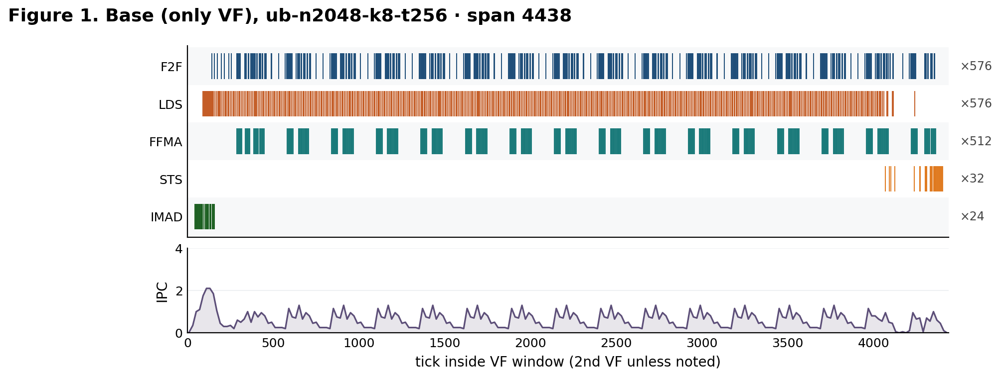
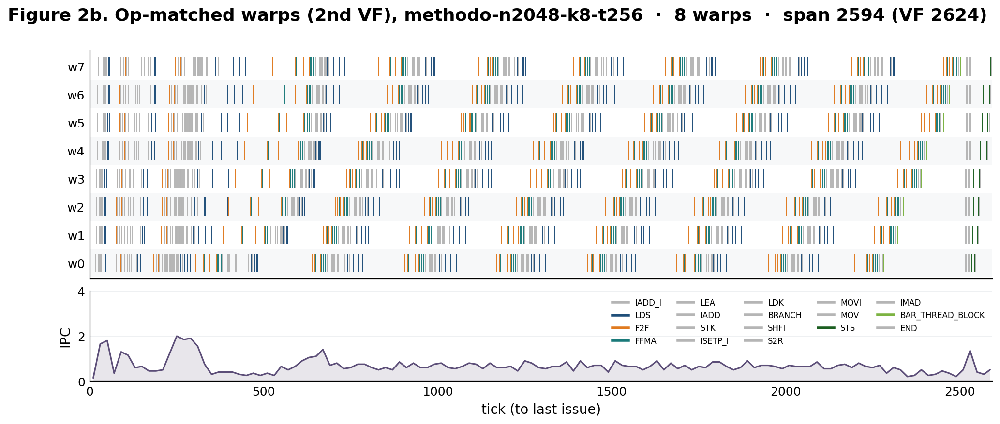
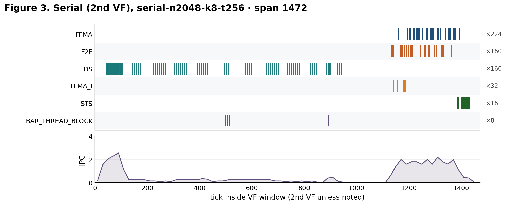
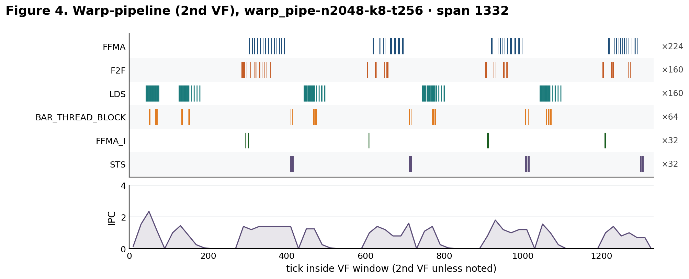
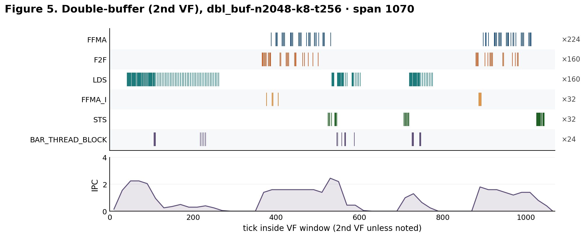
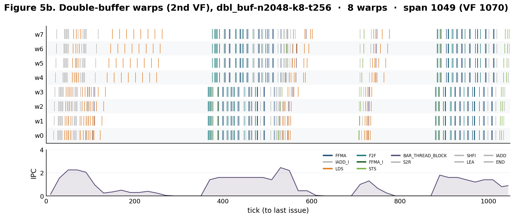
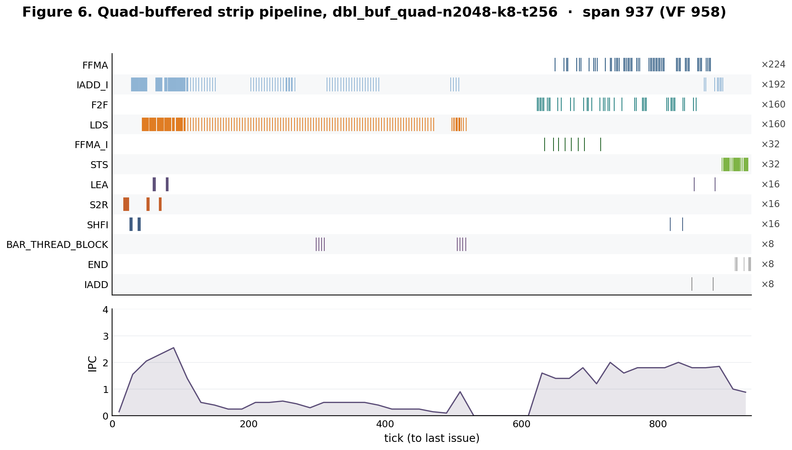
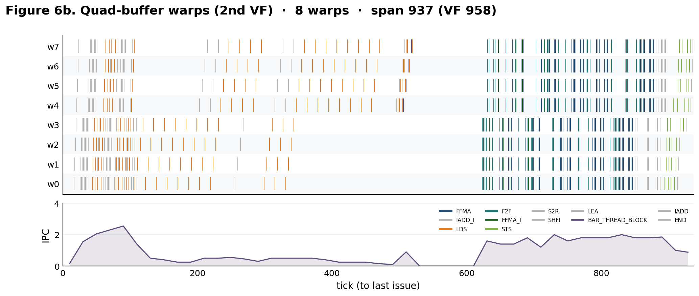
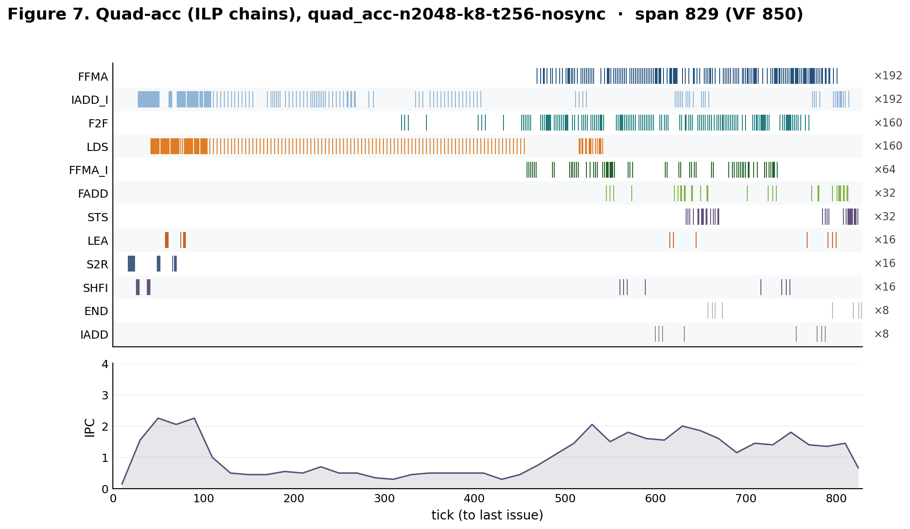

# SV3 theoretical

- Case: `N = 2048`, `K = 8`, buffer staging, 256 threads — `schedules/runs/ub-n2048-k8-t256`.
- Largest spill-free serial tile at 256 threads (`N = 4096` spills under serial → excluded).
- Loads with `LDS`. GM/`LDG` thread case at the same shape is not modeled.
- TileLang kernels: base, op-matched, serial, warp-pipeline, double-buffer, quad-buffer, quad-acc (`schedules/kernels.py` (all builders; base via `build_thread_ub`)).
- §2 rates and §4.2 `serialv4` probe are CCE/`.asc` microbenches — not TileLang.
- Dead-end variants and side measurements live in §5 (Exploration Notes) and `schedules/results/lds_improve.txt`.

**Accounting (2nd VF).** First VF launches can carry a long 0-IPC / post-`END` gap (`I-cache_miss.md`). Multi-launch cases: **rates and charts use VF[1] only**; full-case VF ≈ `2 × span(VF[1])`. Base has one VF. Provenance: `schedules/results/second_vf.txt`.

## 1. Kernel Flow

```text
GM ──MTE2──> UB  (A fp16, x fp16)          # outside the VF window
VF:
  LDS    fp16      : read A and x from UB
  F2F    fp16→fp32 : convert (x re-converted per thread in base)
  FFMA   fp32      : acc += (float)a * (float)xk
  STS    fp32      : write accumulators to out_ub
UB ──MTE3──> GM  (Out fp32)                 # outside the VF window
```

**Table 1. Operator dtypes and bytes per warp issue.**

| Operator | Dtype | Bytes/elements per warp issue |
|---|---|---|
| LDS | fp16 | 64 B (scalar) / **128 B packed** |
| F2F | fp16 → fp32 | 32 values (scalar) / 64 packed |
| FFMA | fp32 | 32 products |
| STS | fp32 | 128 B |

## 2. Theoretical Estimation (from Single Instr)

- Rates from 256-thread single-op lines in `simt-uarch.md` (widest-issue schedule):
  - **LDS** Schedules 2–4 (typed/`uint32` pack) **81.11 B/cyc**
  - **F2F** Schedule 4 (packed barrier-aligned) **107.79 el/cyc** — 256t only; collapses at 1024t (30.65, `simt-uarch.md` §1024)
  - **FFMA** Schedule 3 (barrier-aligned) **20.90 el/cyc** (lower bound — §4.4; 26.01 @1024t)
  - **STS** Schedule 1 (coalesced) **92.30 B/cyc** (99.60 @1024t)
- Size-scaled pure LDS.b32 peaks higher (**76.38 @256 / 95.95 @512**); SoftLib ≈114 still open. GEMV theory uses the fp16 pack line (81.11).
- Work = unique algorithm traffic (`2·N·K + 2·K` LDS B, `N·K + K` F2F, `N·K` FFMA, `4·N` STS B).

**Table 2. 256-thread theoretical rates vs base case window.**

| Operator | Implementation | Theoretical, 256 t | Case window rate | Case / theory |
|---|---|---:|---:|---:|
| LDS | Schedules 2–4 — typed/`u32` pack | 81.11 B/cyc | 7.73 B/cyc | 0.10 |
| F2F | Schedule 4 — packed barrier-aligned | 107.79 el/cyc | 6.87 el/cyc | 0.06 |
| FFMA | Schedule 3 — barrier-aligned | 20.90 el/cyc | 8.60 el/cyc | 0.41 |
| STS | coalesced store | 92.30 B/cyc | 22.51 B/cyc | 0.24 |

**Table 3. Serial model at theoretical rates.**

| Operator | Theoretical | Work | Cycles |
|---|---|---:|---:|
| LDS | 81.11 B/cyc | 32784 B | 404.2 |
| F2F | 107.79 el/cyc | 16392 values | 152.1 |
| FFMA | 20.90 el/cyc | 16384 partials | 783.9 |
| STS | 92.30 B/cyc | 8192 B | 88.8 |
| **Sum (serial model)** | | | **1429.0** |
| **Measured VF (base)** | | | **4438** |

- Back-to-back at theory → **1429** cycles; base measured VF is **3.11×** that sum.

## 3. Case Implementation

- Same shape for all: `N = 2048`, `K = 8`, 256 threads.
- Effective rates = unique work ÷ opcode busy-union on **VF[1]** (tables scale busy ×2 so work columns stay full `N=2048`).
- Full-case VF = `2 × span(VF[1])`. Charts: opcode IPC + warp IPC (2nd VF; base = only VF).

### 3.1 Base

- `schedules/runs/ub-n2048-k8-t256` — default TileLang buffer GEMV.
- One VF (full `A` in UB): **4438**, IPC 0.63, `PASS`, no spills.

| Expectation (§2) | Base does |
|---|---|
| LDS pack ~81 B/cyc | Scalar fp16 LDS, 7.73 B/cyc |
| F2F Schedule 4 ~108 el/cyc | Scalar convert after each load |
| FFMA Schedule 3 ~21 el/cyc | Multiply after each convert |
| Coalesced STS burst | 32 stores, busy union 364 |




- Address adds track narrow loads; holes between load groups are the per-element `F2F→FFMA→STS` chain.
- First `LDS` ~90 cycles after VF start (pointer setup).
- Live state small (`acc[8]` + scalar `xk`) → no spills.

**Table 4. Base effective rates vs theoretical.**

| Operator | Work | Busy | Effective | Theoretical |
|---|---:|---:|---:|---:|
| LDS | 32784 B | 4241 | **7.73 B/cyc** | 81.11 B/cyc |
| F2F | 16392 el | 2386 | **6.87 el/cyc** | 107.79 el/cyc |
| FFMA | 16384 el | 1905 | **8.60 el/cyc** | 20.90 el/cyc |
| STS | 8192 B | 364 | **22.51 B/cyc** | 92.30 B/cyc |

### 3.2 Op-matched (methodology)

- `schedules/runs/methodo-n2048-k8-t256` (`build_ub_methodo`).
- Aims for shapes TileLang can emit: convert `x` once (packed `__half22float2`), fragment accumulators, packed `float2` STS.
- Two slabs; **2nd-VF span 2624** → full-case **5248**, IPC 0.67 on VF[1], `PASS`.
- **I-cache / first-launch:** VF[0] span 3120 vs VF[1] 2624 — cold tax on launch 0; rates from VF[1].

Still not theory:

- `A` stays scalar (64 B `LDS`/el); packed LDS does not appear.
- **128 spill pairs** (`LDK`+`STK`) from `acc[4]`+`xf[8]`.




- Issue counts match base (576 / 576 / 512 / 32).
- STS wins (packed `float2`, busy 364 → 166); spills still make VF slower than base.

**Table 5. Op-matched effective rates vs theoretical (2nd VF ×2).**

| Operator | Work | Busy (2×VF[1]) | Effective | Theoretical |
|---|---:|---:|---:|---:|
| LDS | 32784 B | 4690 | **6.99 B/cyc** | 81.11 B/cyc |
| F2F | 16392 el | 4054 | **4.05 el/cyc** | 107.79 el/cyc |
| FFMA | 16384 el | 3310 | **4.95 el/cyc** | 20.90 el/cyc |
| STS | 8192 B | 166 | **49.35 B/cyc** | 92.30 B/cyc |

### 3.3 Serial

- `schedules/runs/serial-n2048-k8-t256` (`build_ub_serial`).
- Per slab: load+convert into `af[32]`+`xf[8]`, then multiply, then store.
- Live **44 fp32/thread** — largest spill-free 256t tile.
- Two slabs; **2nd-VF span 1472** → full-case **2944**, IPC 0.57, `PASS`, **no spills**.
- **I-cache / first-launch:** VF[0] 1488 vs VF[1] 1472 — small cold delta here; still quote VF[1].




0-IPC stretches (structural, not cold I-cache):

- **LDS→F2F load-return drain** (~150–190 ticks once per launch): converts wait on UB returns (~1/8 ticks).
- **Small holes inside the load band** (~7–52 ticks): same return-queue back-pressure.
- Inter-slab MTE2 (~760 ticks) is outside this VF window.

Other notes:

- Stages read cleanly: dense `LDS`/`F2F` → `FFMA` → `STS`.
- Packed conversion (320 `F2F` vs base’s 576); F2F effective **47.13** (below Schedule 4 **107.79**).
- FFMA busy = `SIMT_FFMA`+`SIMT_FFMA_I` (**506**).

**Table 6. Serial effective rates vs theoretical (2nd VF ×2).**

| Operator | Work | Busy (2×VF[1]) | Effective | Theoretical |
|---|---:|---:|---:|---:|
| LDS | 32784 B | 2170 | **15.12 B/cyc** | 81.11 B/cyc |
| F2F | 16392 el | 348 | **47.13 el/cyc** | 107.79 el/cyc |
| FFMA | 16384 el | 506 | **32.38 el/cyc** | 20.90 el/cyc |
| STS | 8192 B | 166 | **49.35 B/cyc** | 92.30 B/cyc |

**Table 7. Serial VF against the model (2nd-VF estimate).**

| Reference | Cycles | Measured 2944 / reference |
|---|---:|---:|
| Serial model sum (Table 3) | 1429 | **2.06×** |
| Base VF | 4438 | **0.66× of base (faster)** |

### 3.4 Warp-pipeline

- Same stage order as serial, but per **strip** of `threads` rows (not whole-slab barrier between stages).
- `schedules/runs/warp_pipe-n2048-k8-t256` (`build_ub_warp_pipe`).
- Two slabs; **2nd-VF span 1332** → full-case **2664**, IPC **0.70**, `PASS`, **no spills**.
- Faster than serial (2664 vs 2944) — **1.86×** theory vs serial’s 2.06×.
- **I-cache / first-launch:** VF[0] 1398 vs VF[1] 1332; rates from VF[1].




- Stages repeat per strip (4 strips × 2 launches).
- LDS effective **24.22 B/cyc** (vs serial 15.12) — strip convert/multiply shortens the whole-slab drain.
- F2F / FFMA / STS below serial’s pure bands (more interleaving); end-to-end still wins on LDS + IPC.

**Table 6b. Warp-pipeline effective rates vs theoretical (2nd VF ×2).**

| Operator | Work | Busy (2×VF[1]) | Effective | Theoretical |
|---|---:|---:|---:|---:|
| LDS | 32784 B | 1354 | **24.22 B/cyc** | 81.11 B/cyc |
| F2F | 16392 el | 390 | **42.05 el/cyc** | 107.79 el/cyc |
| FFMA | 16384 el | 778 | **21.06 el/cyc** | 20.90 el/cyc |
| STS | 8192 B | 224 | **36.57 B/cyc** | 92.30 B/cyc |

**Table 7b. Warp-pipeline VF against the model (2nd-VF estimate).**

| Reference | Cycles | Measured 2664 / reference |
|---|---:|---:|
| Serial model sum (Table 3) | 1429 | **1.86×** |
| Serial VF | 2944 | **0.90× of serial (faster)** |
| Base VF | 4438 | **0.60× of base** |

### 3.5 Double-buffer

- Prefetch strip `t+1` into `af0`/`af1` while multiplying+storing strip `t` — overlaps in-flight LDS with FFMA.
- `schedules/runs/dbl_buf-n2048-k8-t256` (`build_ub_dbl_buf`).
- **2nd-VF span 1070** → full-case **2140**, IPC **0.83**, `PASS`, no spills.
- Fastest TileLang schedule at the time (beats warp-pipe 2664 and serial 2944); quad-buffer (§3.6) and quad-acc (§3.7) improve further.
- **I-cache / first-launch:** VF[0] 1617 / post-`END` **~547** vs VF[1] 1070 / post-last **22**. Confirmed with `dbl_buf_twice` (1st 1646 / 582; 2nd+ 1070 / 22). **Rates and charts use VF[1].**





Two kinds of IPC = 0:

- **Cold first-launch blank** — removed from this chart (VF[1] only).
- **Structural `LDS→F2F` drains** — still visible (~280–350, ~620–680, ~780–860): converts wait on that strip’s own load returns. Overlap hides some of it, not all.

**Table 6c. Double-buffer effective rates vs theoretical (2nd VF ×2).**

| Operator | Work | Busy (2×VF[1]) | Effective | Theoretical |
|---|---:|---:|---:|---:|
| LDS | 32784 B | 1276 | **25.71 B/cyc** | 81.11 B/cyc |
| F2F | 16392 el | 346 | **47.40 el/cyc** | 107.79 el/cyc |
| FFMA | 16384 el | 566 | **28.95 el/cyc** | 20.90 el/cyc |
| STS | 8192 B | 268 | **30.57 B/cyc** | 92.30 B/cyc |

- First-launch tax closed: all-VF 2687 → **2140** est. Remaining gap to 1429 = IADD/issue density + strip LDS drains.

### 3.6 Quad-buffer

- Prefetch strips `t+1..t+3` into `af0..af3` before multiplying+storing strip `t` — the whole slab's `A` loads issue as **one contiguous band** instead of dbl-buf's three latency-drained bursts.
- `schedules/runs/dbl_buf_quad-n2048-k8-t256` (`build_ub_dbl_buf_quad`, `schedules/kernels.py`).
- Why: dbl-buf keeps only **2 `uint2` loads in flight per thread** (one strip ahead). The VF[1] trace shows 3 LDS bursts ([42–262] [534–600] [720–760], relative to window start) with **~270-tick 0-LDS holes**; issue rate inside a burst collapses 0.85 → 0.25/cyc while per-issue latency inflates 27 → 98 ticks (return-queue saturation at 8 warps). Quad puts **8 `uint2` in flight per thread**.
- Shape (`N=2048, K=8, t=256`): slab 1024 → **4 strips**; prolog loads strips 0–2, the single steady step prefetches strip 3 while strip 0 is multiplied+stored, epilog multiplies+stores strips 1–3.
- Two slabs; **2nd-VF span 958** → full-case **1916**, IPC **0.71**, `PASS`, no spills.
- **I-cache / first-launch:** VF[0] 1512 / post-last-issue tail **560** vs VF[1] 958 / tail **22** — same cold-tax pattern as dbl-buf. **Rates and charts use VF[1].**





- The LDS band is one merged burst (~40–500); the dbl-buf holes are gone — that is the −10.5%.
- The band's mid-issue rate stays ~0.25 LDS/cyc with ~98-tick latencies: row-per-thread loads stride lanes **16 B** apart, ~4× UB bank replay. More prefetch cannot fix that; it needs a relayout (`schedules/results/lds_improve.txt`).

**Table 6d. Quad-buffer effective rates vs theoretical (2nd VF ×2).**

| Operator | Work | Busy (2×VF[1]) | Effective | Theoretical |
|---|---:|---:|---:|---:|
| LDS | 32784 B | 1146 | **28.60 B/cyc** | 81.11 B/cyc |
| F2F | 16392 el | 352 | **46.57 el/cyc** | 107.79 el/cyc |
| FFMA | 16384 el | 482 | **33.99 el/cyc** | 20.90 el/cyc |
| STS | 8192 B | 116 | **70.62 B/cyc** | 92.30 B/cyc |

**Table 7c. Quad-buffer VF against the model (2nd-VF estimate).**

| Reference | Cycles | Measured 1916 / reference |
|---|---:|---:|
| Serial model sum (Table 3) | 1429 | **1.34×** |
| Serial VF | 2944 | **0.65× of serial (faster)** |
| Warp-pipe VF | 2664 | **0.72× of warp-pipe (faster)** |
| Dbl-buf VF | 2140 | **0.90× of dbl-buf (faster)** |

### 3.7 Quad-acc

- Same quad strip buffering as §3.6, but the FFMA chains are **split across independent accumulators** and the control flow is **straight-line** (no `t`-loop, no `% 4` modular branches — specialized to the `n_strips == 4` shape).
- `schedules/runs/quad_acc-n2048-k8-t256-nosync` (`build_ub_quad_acc`, measured with `tl.disable_thread_storage_sync` — see §5 for the barrier lever).
- Why: after barrier removal the steady VF is still ~840–850; the remaining tail is an **8-deep serial FFMA dependency** per strip (`acc += af[n,k]*xf[k]`, `k=0..7`). Strips are mutually independent, so their chains can interleave. Even/odd indexing inside one `T.Parallel` body is rejected by the Ascend structural-equal check; the compiling workaround is to **split fragments into 4-col halves** (`af0a`/`af0b`, …) so each buffer sees one index expression per body.
- Shape: prolog loads strips 0–2 (halved fragments); steady prefetches strip 3 then macs strip 0 on 2 chains (depth 4); epilog advances **6 chains** (strips 1–3 × 2 halves) in one `k` loop, then stores.
- Two slabs; **2nd-VF span 850** → full-case **1700**, IPC **1.05**, `PASS`, no spills.
- **I-cache / first-launch:** VF[0] **853** / tail **22** vs VF[1] **850** / tail **22** — cold tax essentially gone (stock quad: VF[0] 1512 / tail 560). Straight-line code is the reason. **Rates and charts use VF[1]** (same convention).




- LDS band still ~[40–520] at ~28.5 B/cyc — same 16-B lane-stride bank-replay floor as §3.6; ILP does not raise LDS.
- F2F/FFMA effective rates look lower than stock quad because their busy unions stretch across the LDS trickle (overlap), not because less work issues.
- Vs barrier-free stock quad (VF[1] 839 → 1678 est.): steady VF is **+11** (850 vs 839); the published win is the collapsed cold VF and the 2-slab launch wall (actual sum **1703** vs stock-quad-nosync **1935**).

**Table 6e. Quad-acc effective rates vs theoretical (2nd VF ×2).**

| Operator | Work | Busy (2×VF[1]) | Effective | Theoretical |
|---|---:|---:|---:|---:|
| LDS | 32784 B | 1150 | **28.51 B/cyc** | 81.11 B/cyc |
| F2F | 16392 el | 712 | **23.02 el/cyc** | 107.79 el/cyc |
| FFMA | 16384 el | 708 | **23.14 el/cyc** | 20.90 el/cyc |
| STS | 8192 B | 230 | **35.62 B/cyc** | 92.30 B/cyc |

**Table 7d. Quad-acc VF against the model (2nd-VF estimate).**

| Reference | Cycles | Measured 1700 / reference |
|---|---:|---:|
| Serial model sum (Table 3) | 1429 | **1.19×** |
| Serial VF | 2944 | **0.58× of serial (faster)** |
| Warp-pipe VF | 2664 | **0.64× of warp-pipe (faster)** |
| Dbl-buf VF | 2140 | **0.79× of dbl-buf (faster)** |
| Quad-buf VF | 1916 | **0.89× of quad-buf (faster)** |

### 3.8 Conclusion

**Table 8. Methods vs theoretical serial sum (2nd-VF full-case estimate).**

`el/cyc` = output elements ÷ full-case VF (`N / VF` = `2048 / VF`).

| Method | VF | el/cyc | vs Theoretical |
|---|---:|---:|---:|
| Theoretical serial sum | 1429 | **1.43** | 1.00× |
| Base (default TileLang) | 4438 | 0.46 | 3.11× |
| Op-matched | 5248 | 0.39 | 3.67× |
| Serial schedule | 2944 | 0.70 | 2.06× |
| Warp-pipeline | 2664 | 0.77 | 1.86× |
| Double-buffer | 2140 | 0.96 | 1.50× |
| Quad-buffer | 1916 | 1.07 | 1.34× |
| **Quad-acc** | **1700** | **1.20** | **1.19×** |

**Table 9. Per-operator effective rate by method (2nd VF; base = only VF).**

| Operator | Theoretical (256 t) | Base | Op-matched | Serial | Warp-pipe | Dbl-buf | Quad-buf | Quad-acc |
|---|---:|---:|---:|---:|---:|---:|---:|---:|
| LDS (B/cyc) | 81.11 | 7.73 | 6.99 | 15.12 | 24.22 | 25.71 | **28.60** | 28.51 |
| F2F (el/cyc) | 107.79 | 6.87 | 4.05 | 47.13 | 42.05 | **47.40** | 46.57 | 23.02 |
| FFMA (el/cyc) | 20.90 | 8.60 | 4.95 | 32.38 | 21.06 | 28.95 | **33.99** | 23.14 |
| STS (B/cyc) | 92.30 | 22.51 | 49.35 | 49.35 | 36.57 | 30.57 | **70.62** | 35.62 |

- **Quad-acc** is the best published schedule (**1.19×**, **1.20 el/cyc**): barrier-free + ILP chains + straight-line code (cold VF ≈ warm VF).
- **Quad-buffer** next (1.34×, 1.07 el/cyc): merged LDS band, still pays `BAR_THREAD_BLOCK` + cold I-cache on VF[0].
- **Double-buffer** (1.50×, 0.96 el/cyc): LDS dead holes between strip bursts remain.
- **Serial** keeps the strongest pure-band FFMA of the non-overlapped schedules (32.38); quad-buf exceeds it (33.99) via strip overlap. Quad-acc’s lower FFMA *effective* rate is busy-union stretch from ILP overlap, not less work.
- **Op-matched** does not buy LDS/F2F/FFMA; spills dominate.
- LDS still far from typed-pack theory (best ~28.6 vs 81.11). The band is **16-B-lane-stride bank-replay bound**; a UB relayout is the next lever, blocked on layout inference (§5, `schedules/results/lds_improve.txt`). SoftLib ~114 / size-scaled ~96 @512t still open.
- F2F practical fused rate ~47 on staged schedules; Schedule 4 microbench 107.79 is the dedicated ceiling (§4.2).

## 4. Limitations

### 4.1 Register file caps the staged schedule

- Serial live state ≈ `(slab/threads)×(K+1)+K` fp32/thread. At `N=4096, K=8, t=256` → **80 live** → **1152 spill pairs**, VF 15394 (`schedules/results/serial_spill_sweep.txt`).
- `N=2048` (44 live) = largest spill-free 256t whole-slab serial tile.
- Op-matched hits earlier: `acc[4]+xf[8]` → **128 spill pairs** (§3.2).
- Warp-pipeline / dbl-buf / quad-buf / quad-acc keep strip-sized scratch → lower pressure at same `N` (quad keeps 4 `af` fragments ≈ 44 fp32/thread; quad-acc splits those into 8 half-fragments + 8 accumulators, still spill-free at this shape).

### 4.2 F2F Schedule 4 does not transfer into a fused kernel

- Tried: split LDS → `asc_syncthreads()` → pure convert → barrier (`schedules/runs/serialv4-n2048-k8-t256`, hand-patched, `PASS`, no spills).
- Warp alignment worked (`{4: 40}` co-issue), but F2F busy barely moved (348 → 346) and VF worsened (2960 → 2994).
- Fast group’s FFMA lands inside slow group’s convert span; barrier syncs threads, not co-issue groups.
- **47.13 el/cyc is the practical fused-kernel F2F rate**; 107.79 needs a dedicated convert window.

### 4.3 No manual thread barrier in the TileLang Ascend DSL

- `asc_syncthreads()` is compiler-emitted only (`codegen_ascend.cc`). No `T.` intrinsic on demand.
- `T.ascend_pipe_barrier("PIPE_V")` is a pipe-hazard barrier, not a warp barrier.
- Schedule 4 convert band cannot be expressed at DSL level; §4.2 required patched `kernel.cpp`.

### 4.4 FFMA: no packed ISA; single-op ceiling unproven

- `float2`-source FFMA still emits scalar `SIMT_FFMA` (`simt-uarch.md` §4).
- Schedule 3’s 20.90 is a **lower bound** (window leaks other warps’ traffic). Serial staged **32.38** already at apparent issue cap.
- Open: re-isolate FFMA microbench so theory sits above 32.38.

### 4.5 LDS: width solved; IADD-free band not

- Typed pack reaches **81.11 B/cyc** @256t but ~1 `IADD_I` per `LDS` keeps issue ~0.63.
- Size-scaled pure LDS.b32: **76.38 @256 / 95.95 @512**; SoftLib ≈114 needs IADD cleared.
- Contiguous layout → bank conflicts (~4 B/cyc); rejected.
- Case kernels still mostly scalar 64 B issues unless convert shape forces word loads.
- Fused-kernel band ceiling is the **16-B lane stride**: row-per-thread `A` loads replay ~4× per issue (§3.6), capping the in-kernel band at ~28.6 B/cyc regardless of prefetch depth or band purity (`schedules/results/lds_improve.txt`). A UB relayout would lift it; blocked on Ascend layout inference.

### 4.6 Mixed-program rates ≠ pure-window theory

- Interleaved schedules fold other pipes into each busy union; case rates sit far below theory lines.
- Serial / warp-pipeline / dbl-buf / quad-buf / quad-acc exist to approach stage ceilings — they converge to practical fused rates, not microbench numbers.

## 5. Exploration Notes

Self-contained log of how the published schedules were reached: what each step targeted, what the trace showed, what was tried next, and which branches died. Numbers are from existing runs (`schedules/results/second_vf.txt`, `schedules/results/lds_improve.txt`, chat measurements) — no new experiments here. Headline schedules stay in §3; this section is the path, including dead ends.

### 5.1 Starting point — base and op-matched

- Focus: get a correct TileLang GEMV (`N=2048`, `K=8`, 256t) and see how far it sits from the §2 serial model (**1429** cycles).
- **Base** (`build_thread_ub`): one VF, scalar per-element `LDS→F2F→FFMA→STS` chain → VF **4438** (**3.11×** theory). Live state tiny → no spills; throughput tiny.
- **Op-matched** (`build_ub_methodo`): aim for packed convert / fragment accumulators / packed STS shapes the ISA likes.
  - STS improved (busy 364 → 166).
  - But `acc[4]+xf[8]` → **128 spill pairs** (`LDK`/`STK`); full-case **5248** — *slower* than base.
- Hole found: register pressure, not “wrong opcodes”, was the first wall. Next goal = **stage the work so live state fits**.

### 5.2 Serial staging

- Focus: separate load+convert from multiply from store so each stage is a dense band (matches the serial model’s operator accounting).
- **Serial** (`build_ub_serial`): per slab, fill `af[32]+xf[8]`, then FFMA, then STS.
  - **44 fp32/thread** live — largest spill-free 256t whole-slab tile (`N=4096` spills → VF 15394).
  - Full-case **2944** (**2.06×** theory) — first big win vs base.
- Holes visible in the VF chart (structural, not cold I-cache):
  - **LDS→F2F load-return drain** (~150–190 ticks): converts wait on UB returns.
  - Small holes inside the load band (return-queue back-pressure).
- Next goal: stop waiting on a whole-slab barrier between stages — pipeline by strip.

### 5.3 Warp-pipeline

- Focus: same stage order as serial, but per **strip of `threads` rows** so one strip’s convert/multiply can overlap another strip’s load drain.
- **Warp-pipe** (`build_ub_warp_pipe`): full-case **2664** (**1.86×** theory), LDS effective **24.22** (vs serial 15.12).
- Hole found: each strip still does `load → wait → convert → multiply → store` in order. The LDS return latency (~27–98 ticks) is only partially covered.
- Next goal: keep the **next strip’s loads in flight** while multiplying the current strip.

### 5.4 Double-buffer (+ I-cache discovery)

- Focus: prefetch strip `t+1` into a second `af` while multiplying+storing strip `t`.
- **Dbl-buf** (`build_ub_dbl_buf`): VF[1] span **1070** → full-case **2140** (**1.50×** theory). Best TileLang schedule at this point.
- Side discovery (see `I-cache_miss.md`): VF[0] was **1617** with post-`END` gap **~547**, while VF[1] was **1070** / tail **22**. Confirmed with `dbl_buf_twice` (1st 1646/582; 2nd+ 1070/22).
  - Fix adopted for all later accounting: **rates and charts use VF[1] only**; full-case ≈ `2 × span(VF[1])`.
- Remaining structural hole on VF[1]: **three short LDS bursts** with **~270-tick 0-LDS holes** between them. Prefetch depth of one strip (= 2 `uint2` in flight/thread) is not enough to cover return latency at 8 warps.
- Next goal: deepen the prefetch window.

### 5.5 Quad-buffer

- Focus: put strips `t+1..t+3` in flight (8 `uint2`/thread) so the slab’s `A` loads issue as one band.
- **Quad-buf** (`build_ub_dbl_buf_quad`): VF[1] **958** → full-case **1916** (**1.34×** theory). LDS holes gone; −10.5% vs dbl-buf.
- New diagnosis on the merged band:
  - Mid-band issue rate ~0.25 LDS/cyc, latency ~98 ticks.
  - Root cause: row-per-thread `A` is **16 B lane stride** → each warp issue spans 16 bank periods → **~4× UB bank replay**.
  - Pure microbenches reach ~76–81 B/cyc with **4 B** lane stride; in-kernel fused band caps ~**28.6 B/cyc** regardless of prefetch depth.
- Attempted fix that **did not compile**: `build_ub_vfsplit` (exchange-buffer relayout to 4-B stride).
  - Blocked on Ascend layout inference (`ProveFragmentContains` → `InverseAffineIterMap`, scale≠1 / nonlinear index).
  - Kept in `schedules/kernels.py` as the layout-inference record only.
- Side probe `dbl_buf_quad_raw` (pure LDS band, F2F deferred): LDS busy stayed **573** — confirms the floor is bank replay, not F2F interference.
- Next levers after the band was merged: (a) drop unnecessary barriers, (b) overlap F2F/FFMA into the LDS trickle, (c) shorten the FFMA dependency tail.

### 5.6 Barrier removal (`BAR_THREAD_BLOCK`)

- Observation: codegen emits `asc_syncthreads()` via the automatic thread-storage-sync pass (`codegen_ascend.cc` `PrintStorageSync`). Quad had **8**/launch; dbl-buf had **24**.
- Why they are unnecessary here: every `out_ub` write is thread-private (`base + threadIdx.x`); `a_ub`/`x_ub` are MTE2-fed with pipe syncs; VF→MTE3 order is `asc_sync_notify/wait` in the wrapper.
- Knob: `pass_configs["tl.disable_thread_storage_sync"] = True` (`--nosync` on `schedules/compile.py`).
- Measured on stock quad: barriers **8 → 0**, VF[1] **958 → 839**, full-case est **1916 → 1678**, correctness `PASS`. Span gain (−119) ≫ barrier instruction cost — arrival was gating STS on the slowest warp’s FFMA chain.
- Caveat: flag disables *all* auto storage syncs for the build; safe only for this no-cross-thread-write family. Opt-in only.
- Later §3.7 / overlap runs were measured **with** `--nosync`.

### 5.7 F2F/LDS overlap attempts (did not move the floor)

Chart read on barrier-free quad: LDS issues ~[44–530], F2F bulk starts ~400 — looks like “convert waits for the whole load”. Tried reordering.

| Variant | Idea | VF[0] / VF[1] | Verdict |
|---|---|---:|---|
| stock quad-nosync | — | 1096 / 839 | baseline (sum 1935) |
| `quad_reord` | FFMA+STS strip `t` first, prefetch last | 1134 / 881 | **worse** — CCE sank stores (STS busy 110→358); LDS trickle unchanged |
| `quad_ilv` | per-k-chunk: convert chunk of `t+3`, then FFMA chunk of `t` | 1124 / 837 | F2F start 400→~260 (overlap achieved); VF[1] span **unchanged** (837≈839) |
| `quad_acc` | 6 independent FFMA chains + straight-line control | **853 / 850** | launch sum **1703**; steady VF ≈ stock-nosync |

- Lesson: overlapping F2F into the LDS trickle works as ordered, but the trickle itself (bank replay) occupies the pipe — filling “empty” issue slots does not shorten a band that is already LDS-busy.
- `quad_acc`’s real gain vs stock-nosync is **not** more LDS/F2F overlap; it is (1) **ILP** on the epilog FFMA tail and (2) **I-cache**: no modular `t`-loop / `% 4` branches → VF[0] ≈ VF[1].

### 5.8 Where that leaves the published path

- Published ladder (§3): base → op-matched → serial → warp-pipe → dbl-buf → quad-buf → **quad-acc**.
- Open wall that no published schedule has broken: **16-B lane-stride LDS bank replay** (~28.5 B/cyc in-kernel vs 81.11 theory). Needs a compiling UB relayout (vfsplit-class), currently blocked on layout inference.
- Other open items stay in §4 (F2F Schedule 4 transfer, FFMA microbench ceiling, SoftLib LDS).

### 5.9 Exploration flow (text)

```text
                    [Base 4438]
                         |
            +------------+------------+
            | try packed shapes       | (spills)
            v                         v
      [Op-matched 5248]         keep going
            |                         |
            +------------+------------+
                         |
                         v
              [Serial 2944]  <-- stage LDS/F2F | FFMA | STS
                         |
              hole: whole-slab stage drains
                         |
                         v
           [Warp-pipe 2664]  <-- per-strip stages
                         |
              hole: strip load-return still uncovered
                         |
                         v
            [Dbl-buf 2140]  <-- prefetch strip t+1
                |      \
                |       \-- side: I-cache miss on VF[0]
                |            => accounting rule: use VF[1]
                |
         hole: 3 LDS bursts + ~270-tick holes
                |
                v
         [Quad-buf 1916]  <-- 4 strips in flight; one LDS band
                |
     +----------+------------------+--------------------+
     |                          |                      |
     v                          v                      v
[vfsplit / relayout]    [--nosync 1678]         [F2F reorder]
  bank-conflict fix      drop BAR_THREAD_BLOCK    reord / ilv
  => layout inference    (safe here; opt-in)     => overlap yes,
     BLOCKS compile                               VF[1] span unchanged
                |
                +-------- measured post-quad work uses --nosync
                |
                v
         [Quad-acc 1700]  <-- ILP chains + straight-line code
                |
                |  steady VF ≈ nosync-quad;
                |  cold VF collapsed (853≈850);
                |  LDS floor unchanged (~28.5 B/cyc)
                |
                v
         [NEXT: compiling UB relayout]
              (still open — §4.5 / §5.5)
```

## Appendix A. Sources and provenance

### A.1 Environment

| Item | Value |
|---|---|
| Device model | Ascend950PR, npusim, SoC `Ascend950PR_9599` |
| SIMT arch | `dav-3510`, warp = 32, 256 threads = 8 warps |
| Device compiler | bisheng (clang 15.0.5), `--npu-arch=dav-3510` |
| CANN | `cann-9.2.0-beta.2` |
| TileLang | `workspace/tilelang` |

### A.2 Where every number comes from

Paths below are relative to `benches/sv3/schedules/` unless noted. Every §3 / §5 TileLang builder lives in **one** file, `kernels.py` (published ladder first, exploration after — see that file’s module docstring).

| Kernel | Builder | Trace (`schedules/runs/…`) |
|---|---|---|
| §3.1 Base | `kernels.py::build_thread_ub` | `ub-n2048-k8-t256/` |
| §3.2 Op-matched | `kernels.py::build_ub_methodo` | `methodo-n2048-k8-t256/` |
| §3.3 Serial | `kernels.py::build_ub_serial` | `serial-n2048-k8-t256/` |
| §3.4 Warp-pipeline | `kernels.py::build_ub_warp_pipe` | `warp_pipe-n2048-k8-t256/` |
| §3.5 Double-buffer | `kernels.py::build_ub_dbl_buf` | `dbl_buf-n2048-k8-t256/` |
| §3.6 Quad-buffer | `kernels.py::build_ub_dbl_buf_quad` | `dbl_buf_quad-n2048-k8-t256/` |
| §3.7 Quad-acc | `kernels.py::build_ub_quad_acc` | `quad_acc-n2048-k8-t256-nosync/` (`--nosync`) |
| §4.2 serialv4 | hand-patched CCE (not TileLang) | `serialv4-n2048-k8-t256/` |
| §5 `--nosync` on stock quad | same as §3.6 + pass config | `dbl_buf_quad-n2048-k8-t256-nosync/` |
| §5 `quad_reord` / `quad_ilv` | `build_ub_quad_reord` / `build_ub_quad_ilv` | `quad_{reord,ilv}-n2048-k8-t256-nosync/` |
| §5 `vfsplit` | `build_ub_vfsplit` (does not compile) | source only; see `results/lds_improve.txt` |
| §5 `dbl_buf_twice` | `build_ub_dbl_buf_twice` | `dbl_buf_twice-n2048-k8-t256/` |

```bash
# from benches/sv3/
${PY} schedules/decode.py <instr.bin> 2048 8 simt
${PY} single-op/analyze.py <instr.bin> SIMT_F2F
```

Charts (opcode + warps, 2nd VF): `simt-uarch/plots/{case,methodo,serial,warp_pipe,dbl_buf,dbl_buf_quad,quad_acc}_ub_k8.png` and `*_warps.png`. Numbers: `schedules/results/second_vf.txt` (+ `schedules/results/lds_improve.txt` for quad / nosync / overlap / quad-acc).

### A.3 Rebuild and remeasure

```bash
source /mnt/fluxdata/Ascend/cann_92b2/cann-9.2.0-beta.2/set_env.sh
SIM_LIB="${ASCEND_HOME_PATH}/tools/simulator/Ascend950PR_9599/lib"
export TL_CAMODEL_LIB="${SIM_LIB}"
export LD_LIBRARY_PATH="${SIM_LIB}:${ASCEND_HOME_PATH}/runtime/lib64/stub:${ASCEND_HOME_PATH}/lib64${LD_LIBRARY_PATH:+:${LD_LIBRARY_PATH}}"
PY=/home/onasismelchiorjeyakumar/workspace/tilelang/.venv/bin/python
cd benches/sv3/schedules

# names: ub|methodo|serial|warp_pipe|dbl_buf|dbl_buf_quad|quad_acc
#        |dbl_buf_twice|quad_reord|quad_ilv   (+ optional --nosync)
${PY} compile.py dbl_buf 2048 8 256
# quad_acc headline numbers used --nosync:
#   ${PY} compile.py quad_acc 2048 8 256 --nosync

cd runs/dbl_buf-n2048-k8-t256
npusim record -s Ascend950 -o ./npusim -g -n 0 \
  "${PY} ../../launch.py ./kernel.so 2048 8" > sim.log 2>&1
${PY} ../../decode.py $(find npusim -name instr.bin | head -1) 2048 8 simt

# opcode + warp charts (2nd VF); matplotlib lives in ~/venv
~/venv/bin/python ../../simt-uarch/tools/instr_vs_ipc.py \
  $(find npusim -name instr.bin | head -1) simt \
  ../../simt-uarch/plots/dbl_buf_ub_k8.png \
  --label "Figure 5. Double-buffered strip pipeline, dbl_buf-n2048-k8-t256" --vf 1
~/venv/bin/python ../../simt-uarch/tools/warpchart.py \
  $(find npusim -name instr.bin | head -1) \
  ../../simt-uarch/plots/dbl_buf_ub_k8_warps.png \
  --label "Figure 5b. Double-buffer warps (2nd VF)" --vf 1
# quad-buffer / quad-acc: same flow with dbl_buf_quad or quad_acc (+ --nosync),
#   matching runs/ dirs, and Figure 6 / 6b / 7 / 7b labels.
```

### A.4 File map

```
SV3/
├── single-op/                 SIMT microbenchmarks (§2 rates; was simt_ops/)
│   ├── *.asc / launch_*.py
│   ├── analyze.py
│   └── results/               provenance .txt logs
├── schedules/                 GEMV schedule ladder (was nk/)
│   ├── kernels.py             ALL §3 + §5 TileLang builders (one file)
│   ├── kernels_legacy.py      ANALYSIS.md thread/warp/simd builders
│   ├── compile.py             codegen + bisheng → runs/<name>-…/kernel.so
│   ├── launch.py / decode.py
│   ├── results/               second_vf.txt, lds_improve.txt, …
│   ├── tools/                 LDS/VF helpers used for §5
│   └── runs/<name>-n2048-k8-t256[-nosync]/
└── simt-uarch/                write-ups + charts
    ├── simt-uarch.md          single-op narrative
    ├── I-cache_miss.md        first-launch 0-IPC gap; Fix G = use 2nd VF
    ├── SV3-theoretical.md     ← this file (§3 schedules, §5 exploration)
    ├── tools/instr_vs_ipc.py  opcode + IPC charts (--vf N)
    ├── tools/warpchart.py     per-warp IPC charts (--vf N)
    └── plots/                 opcode + *_warps.png for every figure
```
