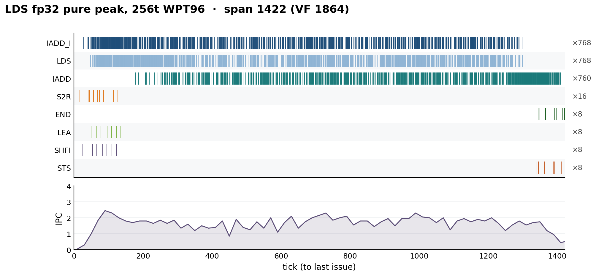
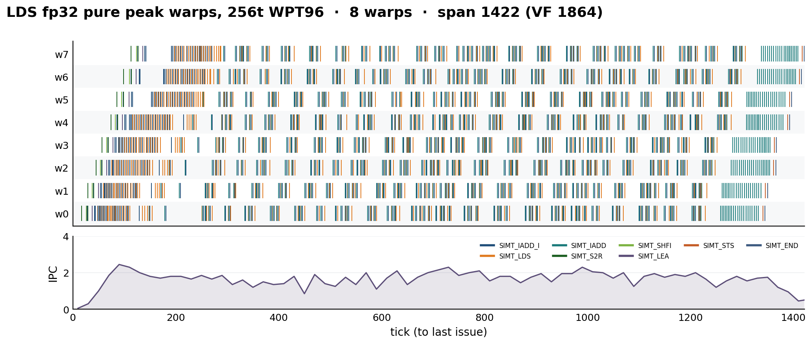
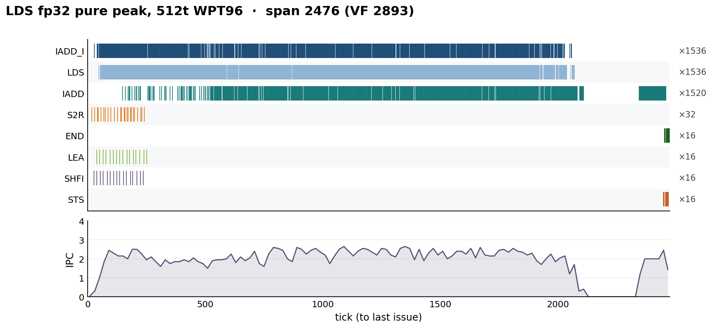
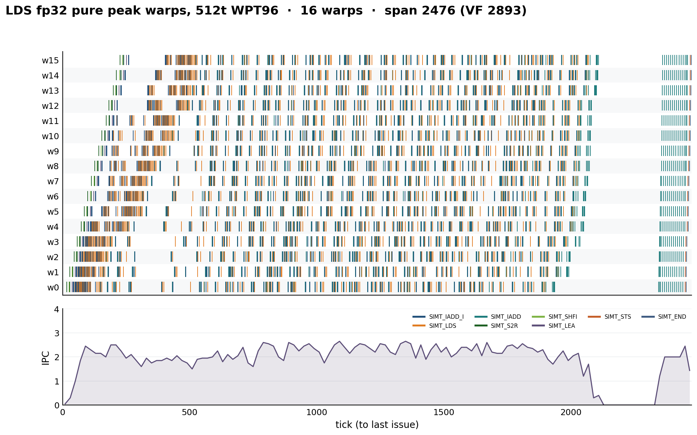
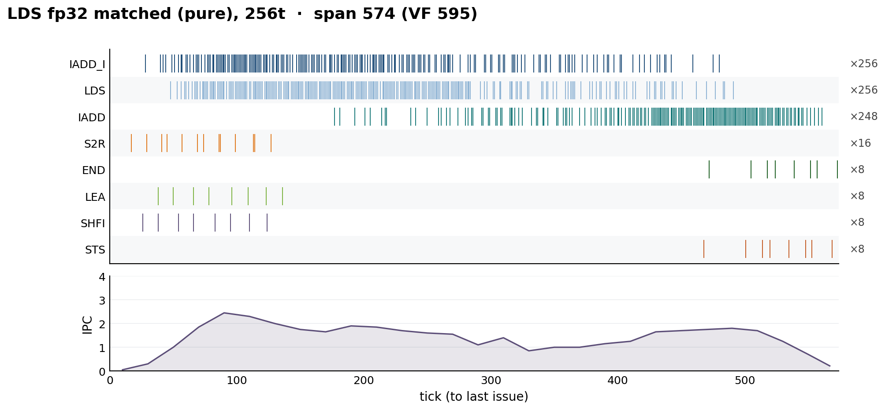
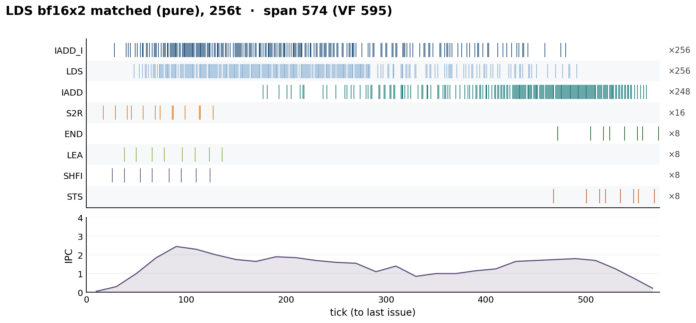
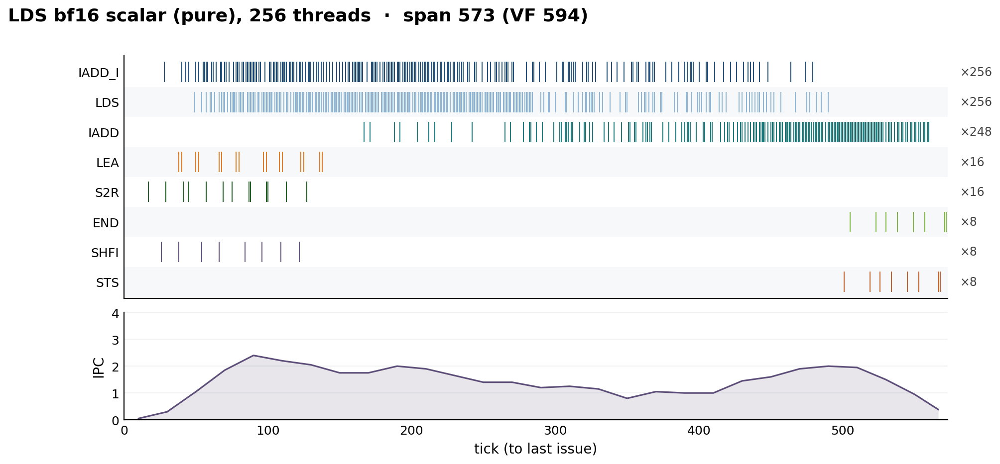

# LDS.32: fp32 vs bf16x2 — max rates, and why packing does not match fp32’s peak

Methodology note. Peaks also recorded in `simt-uarch.md` §2 (size-scaled pure LDS.b32).

All rates from **`../single-op/lds_pure_burst.asc`** + `../single-op/launch_lds_pure.py` (busy-union on `SIMT_LDS`).
Variants sweep (2026-11-13): `../single-op/results/lds_variants_results.txt` (`lds_ptrwalk_bench.asc`, `lds_mlp_bench.asc`, `lds_v4_probe.asc`, `lds_preaddr_bench.asc`).

## 1. What “LDS.32” means

- **LDS.b32** = 32-bit load / lane → warp **128 B/issue** (dtype-agnostic).
- SoftLib IADD-free line: **~115 B/cyc**. SV8 fp32 peak quote: **114.32 @1024t**.

```text
LDS.b16 (scalar bf16):   lane → 2 B  →  64 B/issue
LDS.b32 (fp32 | bf16x2): lane → 4 B  → 128 B/issue   ← “LDS.32”
```

`bfloat16x2_t` only makes the **load width** match fp32. It does not change address math or SoftLib’s IADD-free requirement.

## 2. Addressing (same for fp32 and bf16x2)

Strided index (bank-friendly):

```text
src[tid + i * THREADS]
```

- **fp32:** thread 0 loads floats `0, T, 2T, …`
- **bf16x2:** `src` is `bfloat16x2_t*` → thread 0’s first load is pair **(bf16 0, bf16 1)**; thread 1 gets **(2, 3)**; then stride by `T` **pairs**.

Contiguous `tid*WPT+i` was tried for IADD removal → severe UB bank conflict (~4 B/cyc). Rejected.
Per-lane float4 (`16 B/lane`) also collapses to **31.21 B/cyc** (med active 98 cyc — same conflict class).

## 3. Max rates we measured (pure, strided)

### 3.1 Size-scaled LDS.b32 peaks

| Kind | Threads | N (units) | WPT | Issues | Busy | B/cyc | iss/cyc |
|---|---:|---:|---:|---:|---:|---:|---:|
| **fp32** | **256** | 24576 | 96 | 768 | 1287 | **76.38** | 0.597 |
| **fp32** | **512** | 49152 | 96 | 1536 | 2049 | **95.95** | 0.750 |
| **fp32** | **1024** | 49152 | 48 | 1536 | 2012 | **97.72** | 0.763 |
| bf16x2 | 512 | 49152 | 96 | 1536 | 2082 | **94.43** | 0.738 |
| **bf16x2** | **1024** | 49152 | 48 | 1536 | 2012 | **97.72** | 0.763 |

- Best @256: **76.38** (WPT=96). More WPT does not reach ~96 — 8 warps cannot raise iss/cyc enough.
- Best @512: **95.95** fp32. Same shape, spill-free to UB.
- **@1024: fp32 == bf16x2 == 97.72** — at 32 warps the bf16x2 busy penalty disappears (both busy 2012). **97.72 is the best LDS.b32 we have measured** (fp32 or bf16x2, any dtype).
- **Thread-count scaling is the lever** (same 1536 issues, N=49152): 384t → **81.41**, 512t → **95.95**, 768t → **97.04**, 1024t → **97.72** (fp32 and bf16x2 identical at 384/768t too). Gains saturate past ~768t.
- **@256t is warp-limited**: sparser WPT does not help (WPT=48 → 71.96, WPT=64 → 76.20, WPT=96 → **76.38** peak, WPT=192 → ~58). With 8 warps the pipe cannot hide load latency; ~76 is the ceiling without more warps.
- @2048t: collapses (~30.5 B/cyc, med active 41) — too many warps hurt scheduling.
- Larger N at fixed threads softens: N=61440 → 95.81 @1024t, 91.98 @512t.

Provenance: `../single-op/results/lds_size_peak_results.txt`, `../single-op/results/lds_variants_results.txt`. Charts: `plots/lds_fp32_peak_t256*.png`, `plots/lds_fp32_peak_t512*.png`.

### 3.2 Fixed small tile (matched issues, 256t)

| Kind | Threads | Issues | Busy | Bytes | B/cyc |
|---|---:|---:|---:|---:|---:|
| fp32 | 256 | 256 | 471 | 32768 | 69.57 |
| bf16x2 (8192 pairs) | 256 | 256 | 471 | 32768 | 69.57 |
| bf16 scalar | 256 | 256 | 468 | 16384 | 35.01 |

At small matched work, fp32 ≡ bf16x2 (same ISA mix).

## 4. Why bf16x2 does **not** deliver more than fp32

### 4.1 At the 512t size peak, bf16x2 is slightly worse

Same `512t / N=49152 / WPT=96`:

```text
fp32    95.95 B/cyc   busy=2049   iss/cyc=0.750
bf16x2  94.43 B/cyc   busy=2082   iss/cyc=0.738
```

Same issue count (1536), still **`IADD_I` 1:1 with `LDS`**, but bf16x2’s busy window is a bit longer → **~1.5 B/cyc** short of fp32.

**At 1024t the gap vanishes**: both busy **2012** → **97.72 B/cyc**. With 32 warps, the latency-hiding headroom covers bf16x2’s extra cycles. Width packing never *exceeds* fp32 — best case is equality.

### 4.2 Packing does not open SoftLib ~114

```text
                 B/issue  ×  iss/cyc   ≈  B/cyc
SoftLib LDS.b32   128     ×  ~0.90     ≈  ~115
our fp32 peak     128     ×  0.763     ≈  97.7
our bf16x2 peak   128     ×  0.763     ≈  97.7
```

SoftLib needs an **IADD-free** band. Both fp32 and bf16x2 still rematerialize `tid + i*T` every load (`IADD_I` 1536 = LDS 1536; `IADD` ~1520 is loop bookkeeping). `bfloat16x2` only equalizes width; it does not clear address ops from the band.

### 4.3 What we tried to clear `IADD_I` (2026-11-13) — all CSE’d back

| Variant | Idea | Result @512t | Result @1024t |
|---|---|---:|---:|
| pointer walk (`p += T`) | carried pointer dep, no per-iter index | 2070 busy (= baseline) | 2012 (= baseline) |
| pre-addressed `addr[i]` array | hoist adds out of load band | 2070 (= baseline) | 2012 (= baseline) |
| unroll ×4 stride batch | materialize 4 indices per group | 2049 (= prior peak) | — |
| per-lane float4 (16 B) | widen past 32 bit | 6300 → 31.21 B/cyc (bank conflict) | — |
| contiguous layout | base+imm indexing | ~4 B/cyc (conflict) | — |

Traces show the **same op mix every time** (`IADD_I` 1:1 with `LDS`): the compiler rematerializes `tid + i*T` regardless of source form. SV1’s ~115 needed **self-scheduled SASS port isolation** (`sep_ptr`, disasm LDS region with zero `IADD`/`LEA`) — not expressible from CCE source. Clearing `IADD_I` at the C level is **not possible with current codegen**.

### 4.4 Remaining headroom is latency hiding, not address ops

- At 97.72 B/cyc, 16→32 warps gained +1.8% (2049 → 2012 busy). More warps (2048t) collapse (30.5).
- **Per-thread-count ceilings (measured):** 256t ≈ **76**, 384t ≈ **81**, 512t ≈ **96**, 768t ≈ **97**, 1024t ≈ **97.7**. GEMV-class kernels pinned to ≤256t cannot reach the 512t+ peak — no source-level workaround found (§4.3).
- To hit 114: busy ≤ **1725** at this size — needs ~0.90 iss/cyc sustained with zero `IADD_I` in the window. Both levers are outside what CCE-level source controls today.

## 5. Charts

### 5.1 fp32 size peak @256 — 76.38 B/cyc





### 5.2 fp32 size peak @512 — 95.95 B/cyc





### 5.3 Small-tile matched @256 — fp32 ≡ bf16x2 @ 69.57





### 5.4 bf16 scalar @256 — 35.01 B/cyc



## 6. Takeaway

| Claim | Result |
|---|---|
| Max @256 (pure LDS.b32) | **76.38** fp32 (WPT=96) — warp-limited ceiling |
| Max @512 (pure LDS.b32) | **95.95** fp32 (WPT=96) |
| Max overall (pure LDS.b32) | **97.72 @1024t — fp32 and bf16x2 tie** |
| bf16x2 vs fp32 | ≤ fp32 at 256/512t; **equal at 384/768/1024t** |
| SoftLib ~114 via bf16x2 pack | **No** — still IADD-bound |
| Clear `IADD_I` from C source | **No** — pointer walk / pre-addr / unroll all CSE back |
| Half-tile bf16x2 “beats” fp32 | Artifact (fewer bytes/issues) |
| Practical fused-kernel LDS | 25.71 B/cyc (SV3 dbl-buf, `SV3-theoretical.md` §3.5) |

## 7. Sources

- SoftLib ~115: `SV1/ANALYSIS.md` §7.1 (`bw_b32_sep_ptr_e8192_t128_mi_off`, self-scheduled SASS).
- SV8 114.32: `SV8/simt-uarch/simt-uarch.md` §1.
- Peaks: `../single-op/results/lds_size_peak_results.txt`, `../single-op/lds_pure_burst.asc`, `../single-op/launch_lds_pure.py`.
- Variants (2026-11-13): `../single-op/results/lds_variants_results.txt` (`lds_ptrwalk_bench.asc`, `lds_mlp_bench.asc`, `lds_v4_probe.asc`, `lds_preaddr_bench.asc`).
